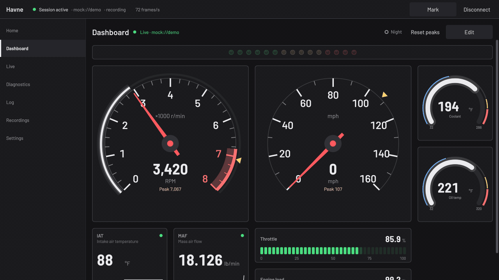
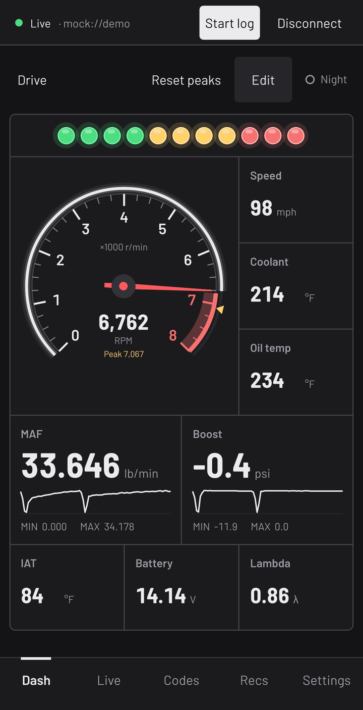
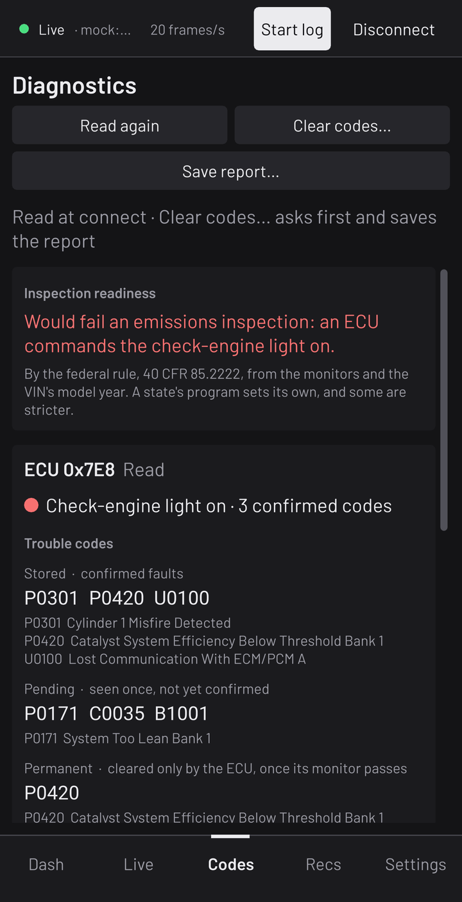
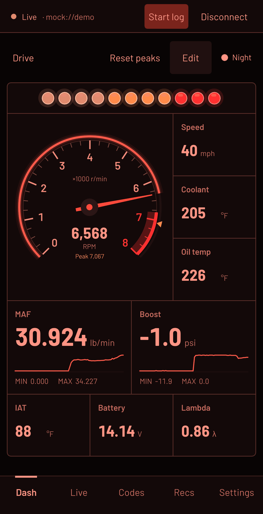

# Havne

_From Norwegian *havn*, a harbor or port: Havne reaches a car through its ports. The verb *havne* is to end up somewhere, as in *havne i grøfta*, in the ditch; staying out of it is still your job._

[](https://github.com/erickramer42/havne/actions/workflows/ci.yml) [](https://codecov.io/gh/erickramer42/havne) [](https://github.com/erickramer42/havne/releases/latest)
[](https://scorecard.dev/viewer/?uri=github.com/erickramer42/havne) [](https://www.bestpractices.dev/projects/15816)

Havne reads a car through J2534, ELM327 or SocketCAN adapters on Windows, Linux and Android: live data, trouble codes, and recordings to replay or share, scrubbed, from an app, `havne-cli` or Python. [Download](https://github.com/erickramer42/havne/releases/latest).

> [!WARNING]
> **Experimental.** Tested on one car. Read [DISCLAIMER.md](DISCLAIMER.md) before connecting it.



*The Dashboard, simulated.*

## Engineering highlights

- **Vendor drivers run out of process.** Each J2534 DLL runs in a surrogate of its own architecture, so a crashing driver ends its process, not the app ([ADR-0025](docs/adr/0025-one-j2534-backend.md)).
- **Fast paths, measured.** The worker decodes with no allocation per frame; a recorded engine start replays at over 300,000 frames a second on the dev machine, and CI repeats the load test ([load test](docs/testing.md#load-test-the-replay-fixture-through-the-bridge)).
- **Measured on a real car.** A second controller on its bus showed Havne's adapter read adding 52 ms; fixing it cut latency from 65.5-73.7 ms to 16.4 ms ([session sheet](docs/bench-sessions/2026-11-05-two-ecu-car-rerun.md)).
- **Protocol logic with no I/O, fuzzed.** The request engine, ISO-TP and the ELM327 layer take no I/O or clock, so rules are unit tests; parsers run fuzzed in CI ([ADR-0015](docs/adr/0015-request-engine.md)).
- **A user's signals are data.** Signal files are JSON that core reads from bytes and refuses at load with line and column, so every platform loads them alike ([ADR-0051](docs/adr/0051-signal-files.md)).
- **Scrubbed by construction, then checked.** An export plans the file from ISO-TP reassembly, then searches every message for the car's VIN and writes nothing on a match ([ADR-0054](docs/adr/0054-exports-and-imports.md)).
- **A stable C ABI.** Opaque handles, flat functions and POD structs with reserved room; CI compiles the headers as strict C and compares the ABI with the last release's ([ADR-0001](docs/adr/0001-qt-free-core-c-abi.md)).
- **Tested in tiers, downloads checkable.** A harness tier drives the J2534 stack against a fake driver, 32-bit included; each release carries signed provenance and an SBOM ([testing.md](docs/testing.md), [ADR-0035](docs/adr/0035-linux-downloads-sbom-reproducible.md)).

## What it does

- **Live data:** a Dashboard built from eight kinds of gauge, Live's table and chart, a Light look for the sun and a Night mode in amber or red, on a schedule if you like; on a phone, a drive view with every bar hidden ([ADR-0057](docs/adr/0057-dashboards.md), [ADR-0059](docs/adr/0059-drive-view.md)).
- **Adapters:** J2534 on Windows; ELM327 over serial, Bluetooth or WiFi, kept running in the background on Android; SocketCAN on Linux, asking so far on a virtual bus ([docs/linux.md](docs/linux.md)).
- **Diagnose:** each ECU's stored, pending and permanent codes with titles, readiness, the freeze frame and an inspection verdict; a clear asks first and saves the report ([ADR-0037](docs/adr/0037-reading-trouble-codes.md)).
- **Profiles, chosen by the URI:** `obd2` polls every Service 01 reading the car supports, `uds-generic` the identifiers you name, `raw` logs frames ([ADR-0039](docs/adr/0039-full-service01-coverage.md)).
- **Your own signals:** signal files and plugins for Service 01 PIDs and Service 22 DIDs on up to four modules, written in Settings or imported from an OBDb set ([signal-files.md](docs/signal-files.md)).
- **Record and review:** every frame and value of a session; the Recordings page pans, zooms, overlays a second run and shows the frames; `replay://` plays one back ([ADR-0049](docs/adr/0049-recordings-in-core.md)).
- **Analysis log:** Start log records the picked signals at the bus's own rate, and `havne-cli export` writes them as a wide CSV, a row a sweep ([ADR-0056](docs/adr/0056-analysis-log.md)).
- **Share:** `havne-cli` exports a recording scrubbed as pcapng, CSV or a folder; the app saves a health report; candump logs and other loggers' CSVs import in both ([ADR-0054](docs/adr/0054-exports-and-imports.md)).
- **`havne-cli` and Python:** any session as JSON lines or iterators, recordings viewed and exported offline, the simulated car served as an ELM327 adapter ([ADR-0031](docs/adr/0031-command-line-client.md), [ADR-0053](docs/adr/0053-python-bindings.md)).
- **A simulated vehicle:** a modeled car through a cold start, pulls onto the limiter and a quarter mile, so every page runs with no hardware.

<table>
<thead>
<tr><th width="33%">Dashboard</th><th width="33%">Codes</th><th width="33%">Dashboard at night</th></tr>
</thead>
<tbody>
<tr>
<td><a href="docs/images/phone-dashboard-dark.png"></a></td>
<td><a href="docs/images/phone-codes.png"></a></td>
<td><a href="docs/images/phone-dashboard-night.png"></a></td>
</tr>
<tr>
<td>The phone layout in a 2nd-gear pull, the shift lights filling</td>
<td>Reading and clearing codes on the test phone</td>
<td>Night in red, for a dark cabin</td>
</tr>
</tbody>
</table>


*Live on the desktop: a 3rd-gear pull onto the limiter, lambda swinging lean on each fuel cut.*

Every page on the desktop and the phone, in Dark and in Night's amber and red: [docs/screenshots.md](docs/screenshots.md).

## Architecture

```
 QML pages: Home · Dashboard · Live · Diagnostics · Log · Recordings · Settings
   ▼  properties and list models, GUI thread only
 SessionBridge (app/)          the app's caller of the core: worker → GUI
   │                           marshaling, 100 ms coalescing, link health
   │   havne-cli (cli/)        a second front end: a session as JSON lines
   │   havne (python/)         a third: ctypes over the shared core, frames and values from its pull queue
   ▼  C ABI: core.h · signals.h · profile.h · plugin.h · obdb.h · j2534.h · serial.h
             stream.h · socketcan.h · vin.h · sim.h · recording.h · queue.h
 ecuio-core (core/)            no Qt, ever: sessions, profiles, signal files, plugins, decoding, recordings
   ├── mock://    a scripted drive on a vehicle model
   ├── replay://  a recording's frames.csv at its own pace
   ├── elm327://  a serial port, a WiFi socket, or a link the app opens
   ├── socketcan:// a Linux CAN interface, listening or through ISO-TP
   │              (havne-cli play drives the simulated car on a virtual one,
   │               havne-cli sim answers as its engine ECU)
   └── j2534://   a surrogate process per driver, over a named pipe
          ├── ecuio-j2534-surrogate.exe      (32-bit drivers)
          └── ecuio-j2534-surrogate-x64.exe  (64-bit drivers)
```

Three rules shape it: **the core never links Qt**; **the UI receives
final display values**, so decoding and units have one home; and **the C
ABI is the boundary**. [docs/architecture.md](docs/architecture.md) walks through
it, a frame's path from transport to screen included.

**Where to look in the code:**

| File | What it shows |
|---|---|
| [`core/src/request_engine.h`](core/src/request_engine.h) | The request engine: pacing, the probe, the DID scan and identification, with no I/O and no clock, so every rule is a unit test |
| [`core/src/isotp.h`](core/src/isotp.h) | ISO-TP on classic CAN, shared by ELM327 and SocketCAN: reassembly, Flow Control, the timers, with no I/O and no clock; fuzzed |
| [`core/src/elm327_protocol.h`](core/src/elm327_protocol.h) | A pure protocol layer: line reading and frame parsing; fuzzed |
| [`core/src/j2534_surrogate_client.cpp`](core/src/j2534_surrogate_client.cpp), [`surrogate/surrogate_main.cpp`](surrogate/surrogate_main.cpp) | Both ends of the out-of-process driver host: the pipe's protections, late replies, a child that dies |
| [`core/src/recorder.cpp`](core/src/recorder.cpp), [`core/src/recording_reader.cpp`](core/src/recording_reader.cpp) | Recordings in core: the worker's single-producer ring to a writer thread that never holds the session, and a reader that answers the viewer from one pass's index; the reader fuzzed |
| [`core/src/signal_file.cpp`](core/src/signal_file.cpp), [`core/src/plugin.cpp`](core/src/plugin.cpp) | A user's signals and a manufacturer's plugins read as data: a strict JSON reader over bytes, each refusal with its line and column, one build of a signal set for both; fuzzed |
| [`core/src/scrub.cpp`](core/src/scrub.cpp), [`core/src/export.cpp`](core/src/export.cpp) | The scrubbed exports: the plan from the frames' reassembly, then the check of every message and the file, which fails the export rather than write the car's identity |
| [`core/src/queue.cpp`](core/src/queue.cpp), [`python/havne/session.py`](python/havne/session.py) | The pull queue: the worker copies into a ring and never waits, the caller's thread reads in batches; Python's iterators over it |
| [`core/src/link_health.h`](core/src/link_health.h) | The link's state machine, shared by both adapter transports |
| [`app/sessionbridge.cpp`](app/sessionbridge.cpp) | The worker-to-GUI boundary: backpressure, coalescing, recording |
| [`cli/main.cpp`](cli/main.cpp), [`cli/line_ring.h`](cli/line_ring.h) | A second front end over the public headers alone: lines formatted on the worker with no allocation, a ring that drops for a live bus and waits for a replay |
| [`core/src/mock_drive_cycle.h`](core/src/mock_drive_cycle.h) | The simulated vehicle and its physics |
| [`core/src/sim_ecu.h`](core/src/sim_ecu.h) | The simulated ECU behind `havne-cli sim`: what it answers, as the simulated car or a recording of the test car, with faults on request; pure, so every answer is a unit test |

## Try it

Download from the [latest release](https://github.com/erickramer42/havne/releases/latest):

- **Windows 10 or 11 (x64):** unzip and run `havne.exe`. It isn't code-signed, so SmartScreen may ask first (**More info**, then **Run anyway**).
- **Android 12 or later:** open the APK on the phone; it's signed with Havne's release key, so each release installs over the last.
- **Linux (x86_64 or 64-bit ARM; glibc 2.39 or later):** make the AppImage executable and run it ([docs/linux.md](docs/linux.md)).
- **Python 3.11 or later:** `pip install` the wheel for your platform, then `python read_pids.py mock://demo` ([`read_pids.py`](python/examples/read_pids.py)) prints the simulated car's readings.

Then in Settings, tick **Developer mode** under Advanced, press the `mock://demo` preset on Connection and **Connect**; with **Record sessions** on, each run opens afterward on the Recordings page.

To build from source you need CMake 3.21+, Qt 6.12 and a C++17 compiler:

```sh
cmake -B build -DCMAKE_PREFIX_PATH=<qt-install>/<kit>
cmake --build build --config Release
ctest --test-dir build -C Release --output-on-failure
```

`-DHAVNE_BUILD_CORE_ONLY=ON` builds the core, `havne-cli` and their tests without Qt; `havne-cli stream mock://demo --values` then streams the simulated car as JSON lines. [docs/development.md](docs/development.md) covers the other platforms and troubleshooting.

## Status

v0.7.1, a more modern look, phone first, is the latest release. Next:

| Version | Plan |
|---|---|
| v0.7.2 | The Dashboard and signals finished: the desktop's panel, undo, a Light look, gauge ranges from signal files, a short user guide |
| v0.7.3-v0.11.0 | The analysis viewer; triggered logging and alerts; the whole car through plugins; discovery of the whole bus; the scan tool |
| 1.0.0 | The finished reader: frozen and hardened, full featured on Windows, Linux and Android |

[STATUS.md](STATUS.md) holds what works, what's verified, the known issues and the roadmap; [CHANGELOG.md](CHANGELOG.md) what each release changed.

## Documentation

| Document | What's in it |
|---|---|
| [docs/user-guide.md](docs/user-guide.md) | Using the app, task by task: connecting, live values, the Dashboard, logs, recordings, codes, vehicles, the drive view |
| [docs/addresses.md](docs/addresses.md) | Every address form and option, with its default and an example |
| [docs/architecture.md](docs/architecture.md) | How the parts fit together and why, and a map of the other docs |
| [docs/adr/](docs/adr/README.md) | The architecture decision records |
| [docs/testing.md](docs/testing.md) | Test tiers, what each test pins, and what isn't verified |
| [docs/signal-files.md](docs/signal-files.md) | Writing your own signals: the format, what's refused at load, using a file, importing an OBDb set |
| [plugins/README.md](plugins/README.md) | Plugins: the package, its variants, the example for the simulated car |
| [docs/j2534.md](docs/j2534.md), [docs/elm327.md](docs/elm327.md) | How each adapter transport works |
| [docs/linux.md](docs/linux.md) | Havne on Linux: the AppImage, the core packages, adapters and permissions, SocketCAN, tracing |
| [docs/ios.md](docs/ios.md) | Havne on iPhone: installing CI's unsigned build with your own Apple ID, what works there |
| [docs/screenshots.md](docs/screenshots.md) | Every page on the desktop and the phone, in each theme |
| [docs/development.md](docs/development.md) | Builds, tests, CI, releases, troubleshooting |
| [docs/bench-sessions/](docs/bench-sessions/bench-prep.md) | Real-hardware sessions, their run sheets, and what only hardware can confirm |
| [docs/engineering-log.md](docs/engineering-log.md) | Milestones and lessons learned |
| [CONTRIBUTING.md](CONTRIBUTING.md), [SECURITY.md](SECURITY.md) | Where to start, the rules a change follows, reporting a vulnerability |

## License

MIT; see [LICENSE](LICENSE). Havne uses [Qt](https://www.qt.io) under
LGPL-3.0; Qt isn't bundled in this repository. Havne is an independent
project, not affiliated with or endorsed by The Qt Company.
