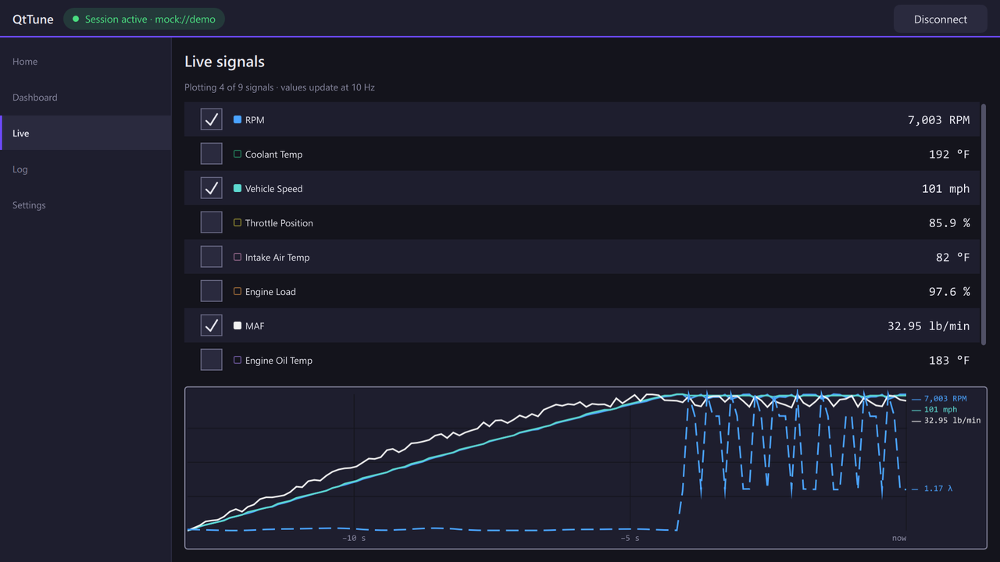
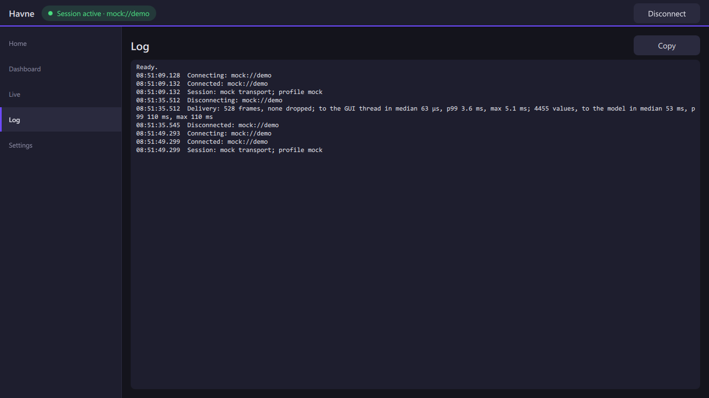
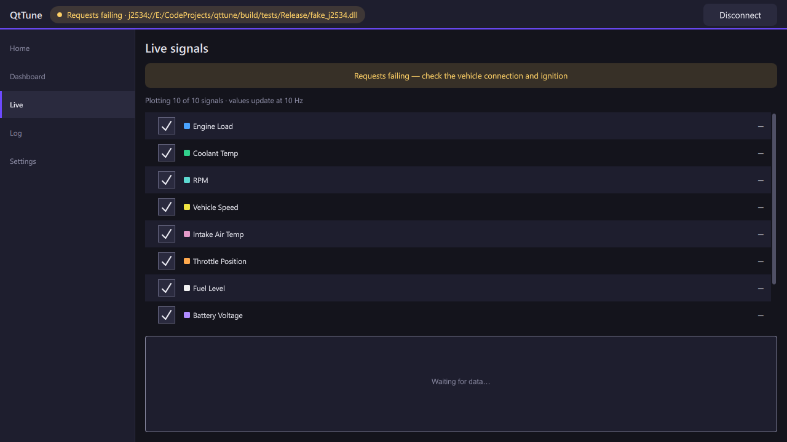

# QtTune

[](https://github.com/erickramer42/qttune/actions/workflows/ci.yml) [](https://codecov.io/gh/erickramer42/qttune) [](https://github.com/erickramer42/qttune/releases/latest)
[](https://scorecard.dev/viewer/?uri=github.com/erickramer42/qttune) [](https://www.bestpractices.dev/projects/15816)

QtTune is a cross-platform OBD-II reader and logger. A Qt-free C++17
core does the vehicle I/O and decoding behind a stable C ABI. A Qt 6 / QML
front end shows the results as gauges, a live strip chart and a raw CAN
frame log. It talks to J2534 Pass-Thru adapters on Windows, and a built-in
simulated vehicle lets it run with no hardware at all.

> [!WARNING]
> **Experimental software.** Tested read-only on one vehicle with one adapter — see [DISCLAIMER.md](DISCLAIMER.md).
>
> QtTune runs end to end against its simulated vehicle and a fake J2534 vendor driver. Through one real adapter, an OBDX Pro VX, it has read live data from one car in two read-only sessions: the engine ECU answered its requests, and the values decoded and tracked the instrument cluster ([session sheet](docs/bench-sessions/2026-10-25-vehicle.md)). Other vehicles and adapters are untested; [STATUS.md](STATUS.md) tracks what is and isn't verified.


*The Dashboard in real time on the built-in simulated vehicle
(`mock://demo`), with no hardware attached: a quarter mile off launch
control on a warm loop, then the lift.*

## Try it

On Windows 10 or 11 (x64), download the zip from the
[latest release](https://github.com/erickramer42/qttune/releases/latest),
unzip it and run `qttune.exe`. Nothing else is needed: Qt and the
Visual C++ runtime are in the zip. The program isn't code-signed, so
SmartScreen may stop it the first time (**More info**, then **Run
anyway**). In Settings, press the `mock://demo` preset and **Connect**
to watch the simulated car drive. Other platforms build from source
([Build](#build)).

## Architecture

```
 QML pages: Home · Dashboard · Live · Log · Settings
   │  Theme (colors, link-state labels) · SignalHub (signals by name)
   ▼  properties and list models, GUI thread only
 QtTuneBridge (app/)          the only caller of the core
   │  worker → GUI marshaling, 100 ms coalescing, link-health polling
   ▼  C ABI: core.h · signals.h · profile.h · j2534.h
 ecuio-core (core/)           no Qt, ever
   │  sessions + callbacks · profiles + decode · transports
   ├── mock://    worker thread, scripted drive cycle
   ├── replay://  worker thread, a recording's frames.csv at its own pace
   └── j2534://   worker thread → loader, which picks a surrogate by the
                  DLL's architecture: client ══ named pipe ══
          ├── ecuio-j2534-surrogate.exe      (x86 process, x86 vendor DLLs)
          └── ecuio-j2534-surrogate-x64.exe  (x64 process, x64 vendor DLLs)
```

Three rules shape it
([ADR-0001](docs/adr/0001-qt-free-core-c-abi.md)):

1. **The core never links Qt.** A CI job builds and tests the core on
   a machine with no Qt, and every configure fails if `ecuio-core`
   links a Qt target.
2. **The UI receives final display values.** Decoding, scaling and
   units live in the core, so QML never parses a frame and there is
   one decode path.
3. **The C ABI is the boundary.** Opaque handles, flat `extern "C"`
   functions and POD structs with reserved room; enum values are
   append-only. It exists so other front ends (mobile, scripting) can
   drive the same core, and a strict-C compile of every public header
   pins it. Its names carry the core's own prefix, `ecuio_` (ECU I/O),
   so they don't change with the product's name.

The full walkthrough, including a frame's path from transport to
screen, is [docs/architecture.md](docs/architecture.md).

## Engineering highlights

- **Vendor drivers isolated in their own process.** The loader reads
  each driver DLL's PE header and loads it in a single-threaded
  surrogate process of the same architecture, 32- or 64-bit, over a
  private named pipe. A driver that crashes ends its surrogate, not the
  app, and every vendor call lands in one session log; the transport
  above can't tell which surrogate it's on
  ([ADR-0008](docs/adr/0008-x86-surrogate-host.md),
  [ADR-0014](docs/adr/0014-single-threaded-surrogate.md),
  [ADR-0025](docs/adr/0025-one-j2534-backend.md)).
- **Link health that names the right problem.** Reads and writes are
  judged separately, so a quiet bus (ignition off, nothing ACKs) isn't
  reported as an adapter fault. While a failure lasts, probing backs
  off from 10 Hz to one try every 5 s.
- **A bounded data path across threads.** Callbacks dispatch from a
  snapshot, so they can unregister without deadlocking, and the worker
  allocates nothing per frame. Core decodes on the transport's thread,
  backpressure bounds frames in flight, and values reach QML at 10 Hz
  whatever the bus rate, each at its frame's time
  ([ADR-0002](docs/adr/0002-callback-pair-identity-snapshot-dispatch.md),
  [ADR-0003](docs/adr/0003-backpressure-bounds-in-flight-frames.md),
  [ADR-0005](docs/adr/0005-coalesced-signal-updates.md),
  [ADR-0024](docs/adr/0024-decode-on-the-worker.md)).
- **Measured under load.** A recorded engine start replayed through
  the app's bridge: the worker sustains over 400,000 frames a second
  through decode, more than 90 times a full classic CAN bus; frames reach
  the GUI thread in under a quarter of a millisecond (median), and
  values reach the pages at the next 10 Hz tick. CI re-runs the load
  test on Windows and Linux for every push, and every session's
  activity log ends with the same figures
  ([docs/testing.md](docs/testing.md#load-test-the-replay-fixture-through-the-bridge)).
- **No fabricated readings.** A value never received shows "—", never
  0, and a value older than 3 s dims.
- **Tested in tiers.** Unit tests cover the core, decoding, the C ABI
  and the bridge (headless). Qt Quick tests run the app's own pages
  against a real bridge, offscreen. A harness tier drives the whole
  J2534 stack against an in-tree fake vendor DLL, through the x64
  surrogate, and locally through the x86 one
  ([docs/testing.md](docs/testing.md)).
- **CI on every push.** Builds and tests on Windows, Linux and macOS;
  runs the core under ASan and UBSan; fuzzes the signal decoder, the
  validators and the `uds-generic` query parser with libFuzzer
  ([fuzz/README.md](fuzz/README.md)); holds the core and the surrogate
  to clang-tidy's analyzer and bug-finding checks, with CodeQL beside
  it; compiles Android and iOS; and, on pull requests, launches the iOS
  app in the Simulator. The coverage badge is line coverage of the
  native code (core, surrogate, bridge) over the whole suite on
  Windows; QML isn't counted
  ([docs/testing.md](docs/testing.md#coverage)).
- **Releases with signed provenance.** Each Windows download is built by a
  tagged workflow that refuses a commit whose CI didn't pass, checks
  the package before zipping it, and attaches a signed SLSA build
  provenance ([docs/development.md](docs/development.md#releases)).
- **Decisions and evidence on record.** Design decisions are
  [ADRs](docs/adr/README.md), lessons go in a dated
  [engineering log](docs/engineering-log.md), and every real-adapter
  session is written up in
  [docs/bench-sessions/](docs/bench-sessions/).

## Features

- **Dashboard.** Analog, ring, digital and bar gauges with shift
  lights, peak hold and stale-value dimming. A gauge whose signal the
  active profile doesn't provide says so instead of showing zero.
- **Live view.** Decoded values with units, refreshed at 10 Hz, plus
  a strip chart that plots each value at its frame's time and keeps
  each 100 ms window's peak.
- **Frame log.** Raw frames, newest-first or oldest-first, with Pause.
- **Fits the screen.** The Dashboard rearranges for a short, wide
  window, pages that run long scroll, and Ctrl + / Ctrl − zooms the
  whole UI (or Settings' Display row), kept between runs.
- **Metric or imperial.** Settings switches every page between km/h,
  °C and g/s and mph, °F and lb/min, chart history included, and
  remembers the choice. Recordings keep the values as the ECU sent
  them ([ADR-0022](docs/adr/0022-display-units.md)).
- **Session recording.** Opt-in: each connect writes every frame,
  every decoded value and the session's events to CSV and text files,
  with host and adapter time side by side
  ([ADR-0017](docs/adr/0017-session-recording.md)).
- **J2534 Pass-Thru (Windows).** Finds installed vendor drivers; pick
  one in Settings or enter a `j2534://` URI. The `obd2` profile
  polls standard Service 01 PIDs, so a bare `j2534://` streams decoded
  signals ([docs/j2534.md](docs/j2534.md)).
- **Protocol profiles.** The URI picks how frames decode: `mock`
  (the default for `mock://`), `obd2` (the default for `j2534://`),
  `raw` (log only), or `uds-generic`, which polls or scans the UDS
  DIDs the URI names, with `?profile=` to choose
  ([ADR-0013](docs/adr/0013-protocol-profiles.md),
  [ADR-0020](docs/adr/0020-uds-generic.md)).
- **Replay.** A recorded session plays back at its own pace, or
  faster: `replay://<recording folder>?profile=obd2&speed=10`
  ([ADR-0023](docs/adr/0023-replay-transport.md)).
- **Simulated vehicle.** A modeled car (gear ratios, airflow and
  torque, tires with weight transfer, block, coolant and oil
  temperatures) runs a scripted drive: a cold start, two full-throttle
  pulls onto a fuel-cut limiter, a highway cruise, then a quarter mile
  off launch control with wheelspin. Only the first loop is cold: each
  later one picks up the heat the last left, so the temperatures climb
  to where a hard-driven car's sit. Its readings stay consistent with
  each other the way a real ECU's log does: rpm with speed and gear,
  airflow with load and lambda. Like a real log they never sit dead
  still: the idle hunts, the driver can't hold a speed to the km/h,
  and the road rises and falls. Every page works with no hardware.

## Screenshots

| Live view | Frame log | Link health |
|---|---|---|
| [](docs/images/live.png) | [](docs/images/log.png) | [](docs/images/link-health.png) |
| A 3rd-gear pull onto the limiter: rpm and speed rise together, then rpm saws while speed holds, MAF stays on its plateau and lambda (dashed) swings lean on each fuel cut | Raw frames as they arrive, with session time, length, the extended-ID flag and payload | Through the in-tree fake J2534 driver with every write refused: the link is judged "requests failing", not idle, and the page says what to check |

## Roadmap

| Version | Milestone | Status |
|---|---|---|
| v0.1.0 | Skeleton: core ABI, Qt shell, responsive layout | ✅ Released |
| v0.2.0 | Callback API, mock transport, live frame log | ✅ Released |
| v0.3.0 | Signal decoding, live view, J2534 transport, live vehicle read and logging (tested on one vehicle) | ✅ Released |
| v0.3.1 | Request engine, PID-support probe, vehicle identification, generic UDS reads, imperial units; the first Windows download | ✅ Released |
| v0.3.2 | Record-replay transport, decoding on the transport's thread, every driver in its own process | ✅ Released |
| v0.4.0 | Security access discovery, flash capability | Proposed |
| v0.5.0+ | Manufacturer plugin modules | Proposed |

The next milestone is still to be chosen from the backlog; the plan
and known issues are in [STATUS.md](STATUS.md), and what each release
changed is in [CHANGELOG.md](CHANGELOG.md).

## Build

| Component | Version | Notes |
|---|---|---|
| CMake | 3.21+ | |
| Qt | 6.12+ (LGPL) | Core, Gui and Quick modules |
| C++ compiler | C++17 | MSVC 2022+, GCC 10+ or Xcode 16+ (Qt 6.12's minimums; a core-only build needs just C++17) |

Installing Qt 6.11+ with aqtinstall needs a workaround; see
[docs/development.md](docs/development.md#installing-qt-with-aqtinstall).

```sh
# Windows (adjust the path to your Qt installation)
cmake -B build -DCMAKE_PREFIX_PATH=<qt-install>/msvc2022_64
cmake --build build --config Release
ctest --test-dir build -C Release --output-on-failure
build/app/Release/qttune.exe

# Linux / macOS
cmake -B build -DCMAKE_PREFIX_PATH=/path/to/qt
cmake --build build
ctest --test-dir build --output-on-failure
build/app/qttune                              # Linux
build/app/qttune.app/Contents/MacOS/qttune    # macOS (an app bundle)
```

To try it without hardware, open **Settings**, pick the `mock://demo`
preset and connect.

Add `-DQTTUNE_BUILD_CORE_ONLY=ON` to build only the core library and
its tests, without Qt.

**32-bit vendor drivers (Windows).** The app tree builds the x64
surrogate itself. 32-bit J2534 drivers, such as the OBDX Pro VX's,
need the x86 surrogate from a second, core-only tree. Build it
**before** configuring `build`: the app's configure step finds it in
`build-win32/` and copies it next to `qttune.exe` on every app build.

```sh
cmake -B build-win32 -A Win32 -DQTTUNE_BUILD_CORE_ONLY=ON
cmake --build build-win32 --config Release --target ecuio-j2534-surrogate fake_j2534 fake_j2534_legacy
```

**Mobile.** The Android and iOS builds compile in CI but haven't run on
a device yet. Their command lines are in
[docs/development.md](docs/development.md), which also covers other
ways to deploy the surrogate, the cross-architecture tests and
troubleshooting.

**Runtime for a source build:** Windows needs a current Microsoft
Visual C++ Redistributable (x64), at least as new as the MSVC that
built the app and Qt; Visual Studio installs one, and the post-build
deploy step doesn't copy it (the release zip carries its own). Linux
and macOS need the Qt runtime libraries.
A J2534 vendor driver is only needed for a real adapter; the tests use
a bundled fake.

## Feedback and contributing

Found a bug, or have a feature in mind?
[Open an issue](https://github.com/erickramer42/qttune/issues) — include
the version, your OS and how you connected, and scrub any logs of
vehicle data (VINs, adapter serials) before attaching them.

Pull requests are welcome; read
[CONTRIBUTING.md](CONTRIBUTING.md) first — it covers the project's
rules (append-only C ABI, Qt-free core, tiered testing) and how to
build and test a change.

## Documentation

| Document | What's in it |
|---|---|
| [docs/architecture.md](docs/architecture.md) | Start here: how the parts fit together and why, plus a map of the other docs |
| [STATUS.md](STATUS.md) | Current state, the plan, known issues, roadmap and backlog |
| [docs/development.md](docs/development.md) | Build configurations, running tests, CI, troubleshooting |
| [docs/testing.md](docs/testing.md) | Test tiers, suites, what is and isn't verified |
| [docs/j2534.md](docs/j2534.md) | How the J2534 transport works |
| [docs/adr/](docs/adr/README.md) | Architecture decision records |
| [CHANGELOG.md](CHANGELOG.md) | What changed in each release |
| [docs/engineering-log.md](docs/engineering-log.md) | Milestone history and lessons learned |
| [docs/bench-sessions/](docs/bench-sessions/bench-prep.md) | Real-hardware sessions, their run sheets, and the assumptions only hardware can confirm |
| [CONTRIBUTING.md](CONTRIBUTING.md) | Reporting bugs, the rules a change must respect, testing and pull requests |
| [SECURITY.md](SECURITY.md) | Reporting a vulnerability; the threat model and its defenses are in [docs/security-assurance.md](docs/security-assurance.md) |

## License

MIT. See the [LICENSE](LICENSE) file.

QtTune uses [Qt](https://www.qt.io), licensed under LGPL-3.0. Qt is
not bundled in this repository; see qt.io for sources and the license
text. QtTune is an independent project, not affiliated with or
endorsed by The Qt Company.
