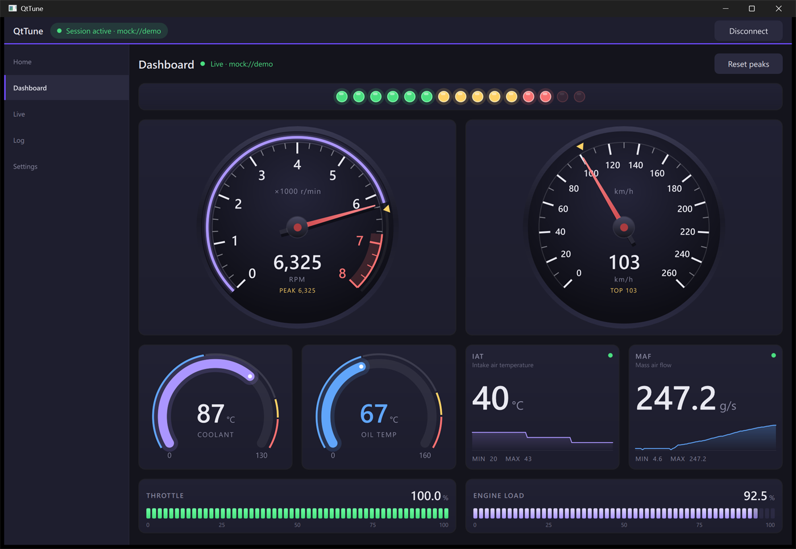

# QtTune

[](https://github.com/erickramer42/qttune/actions/workflows/ci.yml)
[](https://scorecard.dev/viewer/?uri=github.com/erickramer42/qttune)

QtTune is a cross-platform OBD-II reader and logger. A Qt-free C++17
core does the vehicle I/O and decoding behind a stable C ABI. A Qt 6 / QML
front end shows the results as gauges, a live strip chart and a raw CAN
frame log. It talks to J2534 Pass-Thru adapters on Windows, and a built-in
simulated vehicle lets it run with no hardware at all.

> [!WARNING]
> **Experimental software.** Tested read-only on one vehicle with one adapter — see [DISCLAIMER.md](DISCLAIMER.md).
>
> QtTune runs end-to-end against the simulator and a fake J2534 vendor driver. Through a real adapter it has read live data from one vehicle: in a read-only session on 2026-10-22 the engine ECU answered its Mode-01 requests and the values decoded and tracked the instrument cluster ([session sheet](docs/bench-sessions/2026-10-22-vehicle.md)). Other vehicles and adapters are untested; [STATUS.md](STATUS.md) tracks what is and isn't verified.



*The Dashboard mid-pull on the built-in simulated vehicle
(`mock://demo`), with no hardware attached.*

## Architecture

```
 QML pages: Home · Dashboard · Live · Log · Settings
   │  Theme (colors, link-state labels) · SignalHub (signals by name)
   ▼  properties and list models, GUI thread only
 QtTuneBridge (app/)          the only caller of the core
   │  worker → GUI marshaling, 100 ms coalescing, link-health polling
   ▼  C ABI: core.h · signals.h · profile.h · j2534.h
 ecuio-core (core/)           no Qt, ever
   │  sessions + callbacks · profiles + decode · transports
   ├── mock://    worker thread, scripted drive cycle
   └── j2534://   worker thread → loader, which picks a backend:
          ├── in-proc:   vendor DLL loaded into the app (x64 DLLs)
          └── surrogate: client ══ named pipe ══ ecuio-j2534-surrogate.exe
                         (x86 process hosting x86 vendor DLLs)
```

Three rules shape it
([ADR-0001](docs/adr/0001-qt-free-core-c-abi.md)):

1. **The core never links Qt.** A CI job builds and tests the core on
   a machine with no Qt, and every configure fails if `ecuio-core`
   links a Qt target.
2. **The UI receives final display values.** Decoding, scaling and
   units live in the core, so QML never parses a frame and there is
   one decode path.
3. **The C ABI is the boundary.** Opaque handles, flat `extern "C"`
   functions and POD structs with reserved room; enum values are
   append-only. It exists so other front ends (mobile, scripting) can
   drive the same core, and a strict-C compile of every public header
   pins it. Its names carry the core's own prefix, `ecuio_` (ECU I/O),
   so they don't change with the product's name.

The full walkthrough, including a frame's path from transport to
screen, is [docs/architecture.md](docs/architecture.md).

## Engineering highlights

- **32-bit vendor drivers in a 64-bit app.** The loader reads each
  driver DLL's PE header. x86 drivers run in a separate,
  single-threaded surrogate process over a private named pipe; the
  transport above can't tell which backend it's on
  ([ADR-0008](docs/adr/0008-x86-surrogate-host.md),
  [ADR-0009](docs/adr/0009-pe-architecture-routing.md),
  [ADR-0014](docs/adr/0014-single-threaded-surrogate.md)).
- **Link health that names the right problem.** Reads and writes are
  judged separately, so a quiet bus (ignition off, nothing ACKs) isn't
  reported as an adapter fault. While a failure lasts, probing backs
  off from 10 Hz to one try every 5 s.
- **A bounded data path across threads.** Callbacks dispatch from a
  snapshot, so they can unregister without deadlocking. Backpressure
  bounds frames in flight, and values reach QML at 10 Hz whatever the
  bus rate
  ([ADR-0002](docs/adr/0002-callback-pair-identity-snapshot-dispatch.md),
  [ADR-0003](docs/adr/0003-backpressure-bounds-in-flight-frames.md),
  [ADR-0005](docs/adr/0005-coalesced-signal-updates.md)).
- **No fabricated readings.** A value never received shows "—", never
  0, and a value older than 3 s dims.
- **Tested in tiers.** Unit tests cover the core, decoding, the C ABI
  and the bridge (headless). A harness tier drives the whole J2534
  stack against an in-tree fake vendor DLL, both in-proc and through
  the surrogate. CI builds and tests on Windows, Linux and macOS, runs
  the core under ASan/UBSan, compiles Android and iOS, and, on pull
  requests, launches the iOS app in the Simulator
  ([docs/testing.md](docs/testing.md)).
- **Decisions and evidence on record.** Design decisions are
  [ADRs](docs/adr/README.md), lessons go in a dated
  [engineering log](docs/engineering-log.md), and every real-adapter
  session is written up in
  [docs/bench-sessions/](docs/bench-sessions/).

## Features

- **Dashboard.** Analog, ring, digital and bar gauges with shift
  lights, peak hold and stale-value dimming. A gauge whose signal the
  active profile doesn't provide says so instead of showing zero.
- **Live view.** Decoded values with units, refreshed at 10 Hz, plus
  a rolling strip chart.
- **Frame log.** Raw frames, newest-first or oldest-first, with Pause.
- **Fits the screen.** The Dashboard rearranges for a short, wide
  window, pages that run long scroll, and Ctrl + / Ctrl − zooms the
  whole UI (or Settings' Display row), kept between runs.
- **Session recording.** Opt-in: each connect writes every frame,
  every decoded value and the session's events to CSV and text files,
  with host and adapter time side by side
  ([ADR-0017](docs/adr/0017-session-recording.md)).
- **J2534 Pass-Thru (Windows).** Finds installed vendor drivers; pick
  one in Settings or enter a `j2534://` URI. The `obd2` profile
  polls standard Mode-01 PIDs, so a bare `j2534://` streams decoded
  signals ([docs/j2534.md](docs/j2534.md)).
- **Protocol profiles.** The URI picks how frames decode: `mock`
  (the default for `mock://`), `obd2` (the default for `j2534://`) or
  `raw` (log only), with `?profile=` to override
  ([ADR-0013](docs/adr/0013-protocol-profiles.md)).
- **Simulated vehicle.** A modelled drivetrain (gear ratios, torque
  curve, heat soak) runs a scripted drive: warm-up, two full-throttle
  pulls into the limiter, then a quarter-mile run. Every page works
  with no hardware.

## Roadmap

| Version | Milestone | Status |
|---|---|---|
| v0.1.0 | Skeleton: core ABI, Qt shell, responsive layout | ✅ Released |
| v0.2.0 | Callback API, mock transport, live frame log | ✅ Released |
| v0.3.0 | Signal decoding, live view, J2534 transport, live vehicle read and logging (tested on one vehicle) | ✅ Released |
| v0.3.x | Request engine, PID-support probe, generic UDS reads, record-replay transport | Next |
| v0.4.0 | Security access discovery, flash capability | Planned |
| v0.5.0+ | Manufacturer plugin modules | Planned |

The phase checklist and known issues are in [STATUS.md](STATUS.md).

## Build

| Component | Version | Notes |
|---|---|---|
| CMake | 3.21+ | |
| Qt | 6.12+ (LGPL) | Core, Gui and Quick modules |
| C++ compiler | C++17 | MSVC 2022+, GCC 10+ or Xcode 16+ (Qt 6.12's minimums; a core-only build needs just C++17) |

Installing Qt 6.11+ with aqtinstall needs a workaround; see
[docs/development.md](docs/development.md#installing-qt-with-aqtinstall).

```sh
# Windows (adjust the path to your Qt installation)
cmake -B build -DCMAKE_PREFIX_PATH=<qt-install>/msvc2022_64
cmake --build build --config Release
ctest --test-dir build -C Release --output-on-failure
build/app/Release/qttune.exe

# Linux / macOS
cmake -B build -DCMAKE_PREFIX_PATH=/path/to/qt
cmake --build build
ctest --test-dir build --output-on-failure
build/app/qttune                              # Linux
build/app/qttune.app/Contents/MacOS/qttune    # macOS (an app bundle)
```

To try it without hardware, open **Settings**, pick the `mock://demo`
preset and connect.

Add `-DQTTUNE_BUILD_CORE_ONLY=ON` to build only the core library and
its tests, without Qt.

**32-bit vendor drivers (Windows, optional).** x86-only J2534 drivers,
such as the OBDX Pro VX's, need the Win32 surrogate from a second
build tree. Build it **before** configuring `build`: the app's
configure step finds it in `build-win32/` and copies it next to
`qttune.exe` on every app build.

```sh
cmake -B build-win32 -A Win32 -DQTTUNE_BUILD_CORE_ONLY=ON
cmake --build build-win32 --config Release --target ecuio-j2534-surrogate fake_j2534 fake_j2534_legacy
```

**Mobile.** The Android and iOS builds compile in CI but haven't run on
a device yet. Their command lines are in
[docs/development.md](docs/development.md), which also covers other
ways to deploy the surrogate, the cross-architecture tests and
troubleshooting.

**Runtime:** Windows needs a current Microsoft Visual C++
Redistributable (x64), at least as new as the MSVC that built the app
and Qt; Visual Studio installs one, and the post-build deploy step
doesn't copy it. Linux and macOS need the Qt runtime libraries.
A J2534 vendor driver is only needed for a real adapter; the tests use
a bundled fake.

## Documentation

| Document | What's in it |
|---|---|
| [docs/architecture.md](docs/architecture.md) | Start here: how the parts fit together and why, plus a map of the other docs |
| [STATUS.md](STATUS.md) | Current state, phase checklist, known issues, detailed roadmap |
| [docs/development.md](docs/development.md) | Build configurations, running tests, CI, troubleshooting |
| [docs/testing.md](docs/testing.md) | Test tiers, suites, what is and isn't verified |
| [docs/j2534.md](docs/j2534.md) | How the J2534 transport works |
| [docs/adr/](docs/adr/README.md) | Architecture decision records |
| [docs/engineering-log.md](docs/engineering-log.md) | Milestone history and lessons learned |

## License

MIT. See the [LICENSE](LICENSE) file.

QtTune uses [Qt](https://www.qt.io), licensed under LGPL-3.0. Qt is
not bundled in this repository; see qt.io for sources and the license
text. QtTune is an independent project, not affiliated with or
endorsed by The Qt Company.
