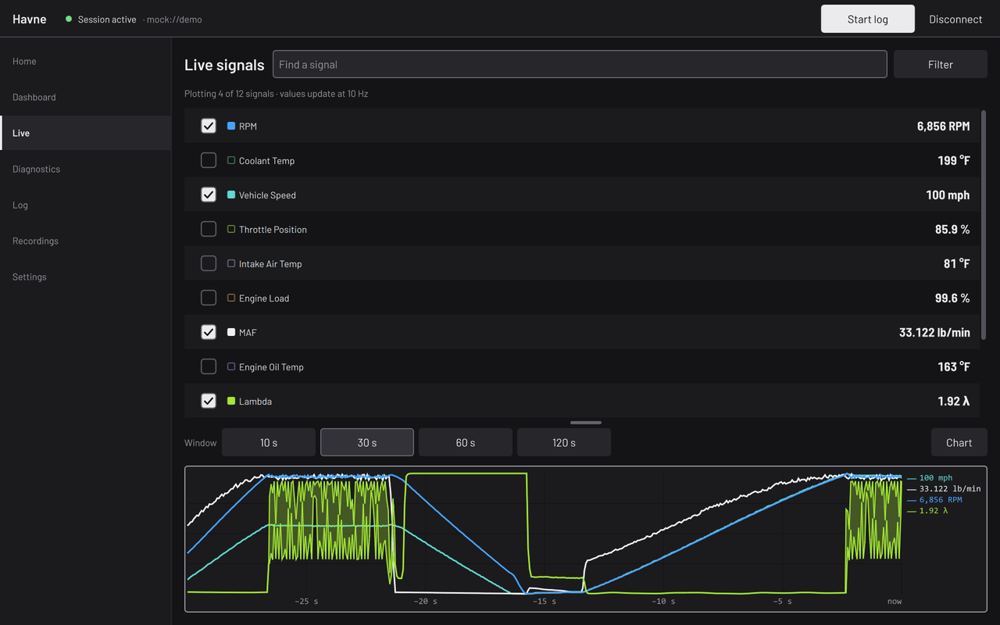
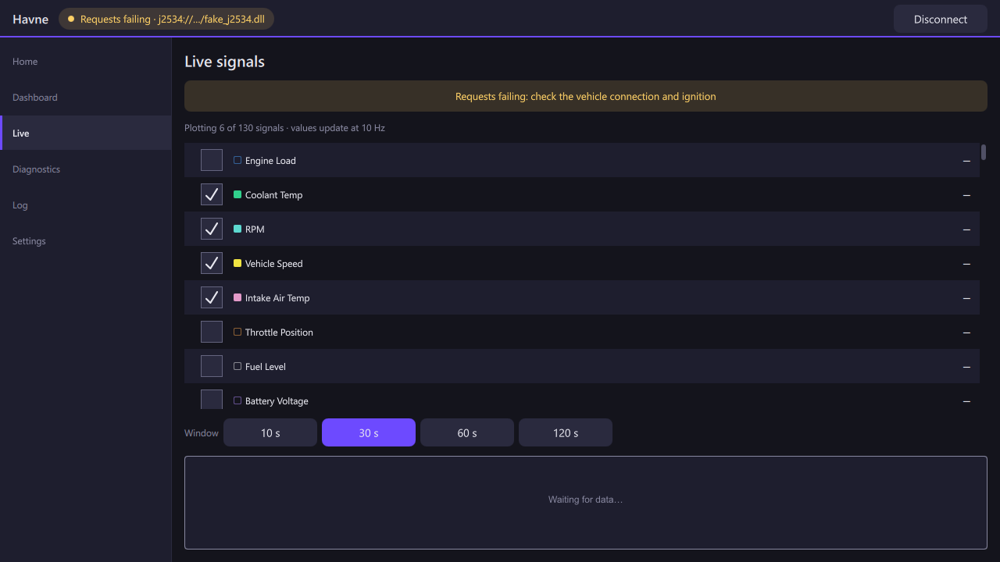

# Havne

_From Norwegian *havn*, a harbor or port: Havne reaches a car through its ports. The verb *havne* is to end up somewhere, as in *havne i grøfta*, in the ditch; staying out of it is still your job._

[](https://github.com/erickramer42/havne/actions/workflows/ci.yml) [](https://codecov.io/gh/erickramer42/havne) [](https://github.com/erickramer42/havne/releases/latest)
[](https://scorecard.dev/viewer/?uri=github.com/erickramer42/havne) [](https://www.bestpractices.dev/projects/15816)

Havne is an OBD-II scan tool and data logger: live gauges, a strip
chart, the trouble codes and readiness monitors, and a log of
every frame, recorded and replayed on request. It runs on Windows,
Linux and Android, builds and passes its tests on macOS, and runs on
the iOS Simulator. It reaches the car through J2534 Pass-Thru adapters
on Windows and ELM327-compatible adapters over USB, Bluetooth or WiFi
everywhere; SocketCAN on Linux has listened through a real controller
on a desk bus, and asked only on a virtual bus so far. A
simulated vehicle runs every page with no hardware.

Underneath is a Qt-free C++17 core that does all the vehicle I/O and
decoding behind a stable C ABI. The Qt 6 / QML app is one front end
over it; `havne-cli`, which streams any session as JSON lines, is a
second, written against the public headers alone.

> [!WARNING]
> **Experimental.** It has read one car through two adapters, from a laptop and from an Android phone; other vehicles and adapters are untested. It can clear trouble codes, after asking and saving them first; it has cleared one car with none stored, with the engine stopped and running, and has erased a stored code only on its fakes and simulated vehicle. Read [DISCLAIMER.md](DISCLAIMER.md) before connecting it to a vehicle.


*The Dashboard on the simulated vehicle (`mock://demo`), in real time:
a quarter mile off launch control on a warm loop.*

## Engineering highlights

- **Vendor drivers run out of process.** Each J2534 DLL, often 32-bit,
  runs in a single-threaded surrogate of its own architecture behind a
  private named pipe, so a crashing driver ends its surrogate, not the
  app ([ADR-0025](docs/adr/0025-one-j2534-backend.md),
  [ADR-0014](docs/adr/0014-single-threaded-surrogate.md)).
- **A bounded, measured data path.** The worker decodes with no
  allocation per frame, backpressure bounds the frames in flight, and
  QML gets values at 10 Hz whatever the bus rate. A recorded engine
  start replays through decode at over 300,000 frames a second, about
  70 times a full classic CAN bus, and CI re-runs that load test on
  every push ([ADR-0024](docs/adr/0024-decode-on-the-worker.md),
  [docs/testing.md](docs/testing.md#load-test-the-replay-fixture-through-the-bridge)).
- **Measured on a real car.** Through both adapters on hand, a J2534
  Pass-Thru on a laptop and an ELM327 on a phone over Bluetooth, the
  test car's two ECUs answered; asking up to six PIDs per request
  brought 2.7 times as many replies a minute, and holding Windows'
  1 ms timer 28 % more. Each session is written up with its scrubbed
  logs ([2026-11-01](docs/bench-sessions/2026-11-01-vehicle.md),
  [2026-11-02](docs/bench-sessions/2026-11-02-vehicle.md)).
- **Requests follow the replies.** One request per ECU at a time; the
  supported-PID probe drops only what the ECU says it lacks, never on
  silence. A clear asks first, saves the report, and asks once more
  while the car moves
  ([ADR-0015](docs/adr/0015-request-engine.md),
  [ADR-0038](docs/adr/0038-clearing-trouble-codes.md)).
- **ISO-TP, held to the kernel's.** Core's own ISO-TP, shared by
  ELM327 and SocketCAN, is tested on a virtual CAN bus against Linux's
  independent implementation, and against a recording of the test car
  answering as the ECU with its replies broken on purpose
  ([ADR-0040](docs/adr/0040-socketcan-requests-isotp.md),
  [ADR-0041](docs/adr/0041-replay-fault-injection.md)).
- **Pure parsers, fuzzed.** The ELM327 wire layer and ISO-TP have no
  I/O, clock or allocation, so every rule is a unit test over canned
  bytes; they and the other parsers run under libFuzzer with ASan and
  UBSan in CI ([fuzz/README.md](fuzz/README.md)).
- **A stable C ABI.** Opaque handles, flat functions, POD structs with
  reserved room; CI compiles every public header as strict C, compares
  the ABI with the last release's and builds the core with no Qt
  installed ([ADR-0001](docs/adr/0001-qt-free-core-c-abi.md)).
- **Verified in tiers, and honest about it.** A harness tier drives the
  whole J2534 stack against an in-tree fake driver, 32-bit included,
  and ELM327 against a fake adapter. What only hardware can confirm is
  listed, each real-hardware session is written up, and each decision
  is an [ADR](docs/adr/README.md) with the alternatives it turned down
  ([docs/testing.md](docs/testing.md),
  [bench-prep.md](docs/bench-sessions/bench-prep.md)).
- **Downloads anyone can check.** Signed build provenance and an SPDX
  SBOM for every download, Linux core packages that build to the same
  bytes, and debug symbols with each release
  ([ADR-0034](docs/adr/0034-debug-symbols-and-probes.md),
  [ADR-0035](docs/adr/0035-linux-downloads-sbom-reproducible.md)).

## What it does

- **The pages:** a Dashboard of gauges with shift lights and peak
  hold; Live, the values and a strip chart; Diagnostics; and a Log of
  every connect and link change, with the raw frames in developer mode.
- **Three kinds of adapter:** J2534 on Windows; ELM327 over a serial
  port, Bluetooth or WiFi, on the desktop and on Android, where
  sessions keep running in the background; SocketCAN on Linux,
  listening (a real controller on a desk bus too) or making requests
  (so far on a virtual bus)
  ([docs/j2534.md](docs/j2534.md),
  [docs/elm327.md](docs/elm327.md), [docs/linux.md](docs/linux.md)).
- **Trouble codes:** each ECU's check-engine light, its stored, pending
  and permanent codes, readiness monitors and freeze frame, read at
  connect, each generic code named offline, and whether the car meets
  the federal inspection's readiness rule; clearing asks first and
  saves the report ([ADR-0037](docs/adr/0037-reading-trouble-codes.md),
  [ADR-0044](docs/adr/0044-trouble-code-titles.md),
  [ADR-0045](docs/adr/0045-inspection-readiness.md)).
- **Profiles chosen by the URI:** `obd2` polls every standard
  Service 01 reading the car has, the fast-changing ones more often;
  `uds-generic` polls or scans the UDS identifiers the URI names; `raw`
  logs frames. The VIN and calibration IDs are read at connect, the
  VIN's model year and make decoded on the device, and each request's
  reply time is measured
  ([ADR-0039](docs/adr/0039-full-service01-coverage.md),
  [ADR-0042](docs/adr/0042-reply-timing.md),
  [ADR-0043](docs/adr/0043-vin-decode.md)).
- **`havne-cli`:** any session's frames, values and link health as JSON
  lines; on Linux, the simulated car or a recording answering requests
  on a virtual CAN bus as the car's engine ECU
  ([ADR-0031](docs/adr/0031-command-line-client.md),
  [ADR-0046](docs/adr/0046-simulated-ecu.md)). An Android phone can
  relay its paired Bluetooth adapter to a computer's `havne-cli` over
  USB ([ADR-0047](docs/adr/0047-adapter-relay.md)).
- **Recording and replay:** every frame, value and event of a connect;
  `replay://` plays it back at its own pace or faster, through the same
  decoding, with faults injected on request
  ([ADR-0023](docs/adr/0023-replay-transport.md)).
- **A simulated vehicle:** a modeled car (gearing, airflow, tire slip,
  coolant and oil heat) drives a cold start, pulls onto the limiter, a
  cruise and a quarter mile, its readings consistent with each other.

| Live view | Link health |
|---|---|
| [](docs/images/live.png) | [](docs/images/link-health.png) |
| A 3rd-gear pull onto the limiter: rpm, speed and MAF rise together, then rpm saws while speed holds and lambda swings lean on each fuel cut | Every request refused by the fake J2534 driver: the link reads "requests failing", not idle, and the page says what to check |


*The Diagnostics page on the simulated vehicle (`mock://demo`): the
inspection verdict, each stored, pending and permanent code with its
SAE J2012 title, and the readiness monitors for this drive and since
the last clear.*


*The Log page on the simulated vehicle (`mock://demo`), in developer
mode: each session as it happened, then the frames as they arrive.*

## Architecture

```
 QML pages: Home · Dashboard · Live · Diagnostics · Log · Settings
   ▼  properties and list models, GUI thread only
 SessionBridge (app/)          the app's caller of the core: worker → GUI
   │                           marshaling, 100 ms coalescing, link health
   │   havne-cli (cli/)        a second front end: a session as JSON lines
   ▼  C ABI: core.h · signals.h · profile.h · j2534.h · serial.h · stream.h · socketcan.h · vin.h · sim.h
 ecuio-core (core/)            no Qt, ever: sessions, profiles, decoding
   ├── mock://    a scripted drive on a vehicle model
   ├── replay://  a recording's frames.csv at its own pace
   ├── elm327://  a serial port, a WiFi socket, or a link the app opens
   ├── socketcan:// a Linux CAN interface, listening or through ISO-TP
   │              (havne-cli play drives the simulated car on a virtual one,
   │               havne-cli sim answers as its engine ECU)
   └── j2534://   a surrogate process per driver, over a named pipe
          ├── ecuio-j2534-surrogate.exe      (32-bit drivers)
          └── ecuio-j2534-surrogate-x64.exe  (64-bit drivers)
```

Three rules shape it: **the core never links Qt**, so other front ends
can drive the same core; **the UI receives final display values**, so
decoding, scaling and units have one home; and **the C ABI is the
boundary**. [docs/architecture.md](docs/architecture.md) walks through
it, a frame's path from transport to screen included.

**Where to look in the code:**

| File | What it shows |
|---|---|
| [`core/src/request_engine.h`](core/src/request_engine.h) | The request engine: pacing, the probe, the DID scan and identification, with no I/O and no clock, so every rule is a unit test |
| [`core/src/isotp.h`](core/src/isotp.h) | ISO-TP on classic CAN, shared by ELM327 and SocketCAN: reassembly, Flow Control, the timers, with no I/O and no clock; fuzzed |
| [`core/src/elm327_protocol.h`](core/src/elm327_protocol.h) | A pure protocol layer: line reading and frame parsing; fuzzed |
| [`core/src/j2534_surrogate_client.cpp`](core/src/j2534_surrogate_client.cpp), [`surrogate/surrogate_main.cpp`](surrogate/surrogate_main.cpp) | Both ends of the out-of-process driver host: the pipe's protections, late replies, a child that dies |
| [`core/src/link_health.h`](core/src/link_health.h) | The link's state machine, shared by both adapter transports |
| [`app/sessionbridge.cpp`](app/sessionbridge.cpp) | The worker-to-GUI boundary: backpressure, coalescing, recording |
| [`cli/main.cpp`](cli/main.cpp), [`cli/line_ring.h`](cli/line_ring.h) | A second front end over the public headers alone: lines formatted on the worker with no allocation, a ring that drops for a live bus and waits for a replay |
| [`core/src/mock_drive_cycle.h`](core/src/mock_drive_cycle.h) | The simulated vehicle and its physics |
| [`core/src/sim_ecu.h`](core/src/sim_ecu.h) | The simulated ECU behind `havne-cli sim`: what it answers, as the simulated car or a recording of the test car, with faults on request; pure, so every answer is a unit test |

## Try it

On Windows 10 or 11 (x64), download the zip from the
[latest release](https://github.com/erickramer42/havne/releases/latest),
unzip it and run `havne.exe`; Qt and the Visual C++ runtime are inside.
It isn't code-signed, so SmartScreen may ask first (**More info**, then
**Run anyway**). On Android 12 or later, download and open the release's
APK on the phone; it's signed with Havne's release key, and each
release installs over the last. On Linux (x86_64, glibc 2.39 or
later), download the AppImage, make it executable and run it;
[docs/linux.md](docs/linux.md) covers what it needs, the core packages
for `havne-cli` and your own programs, serial permissions and
SocketCAN. In Settings, tick **Developer mode** under Display, then
press the `mock://demo` preset and **Connect**.

To build from source you need CMake 3.21+, Qt 6.12 and a C++17
compiler:

```sh
cmake -B build -DCMAKE_PREFIX_PATH=<qt-install>/<kit>
cmake --build build --config Release
ctest --test-dir build -C Release --output-on-failure
```

`-DHAVNE_BUILD_CORE_ONLY=ON` builds the core, `havne-cli` and their
tests without Qt; `havne-cli stream mock://demo --values` then streams
the simulated car as JSON lines.
[docs/development.md](docs/development.md) covers the 32-bit
surrogate's second tree, Linux, macOS, Android and iOS, and
troubleshooting.

## Status

v0.3.6 (trouble codes by name, VIN decode and inspection readiness,
clearing with the engine running, the simulated ECU, the phone as a
relay, and car runs through both adapters on hand) is the latest
release. Next:

| Version | Plan |
|---|---|
| v0.4.0 | Recordings in core and a log viewer that overlays runs, in the app and `havne-cli`; finding a signal among many; SocketCAN through a real controller |
| v0.5.0-v0.9.0 | Your own PIDs and DIDs, imported in bulk, and computed signals such as boost; manufacturer data through plugins; exports, imports and Python; triggered logging and alerts; discovery of every module; the scan tool |
| 1.0.0 | The finished reader: frozen and hardened, full featured on Windows, Linux and Android |

[STATUS.md](STATUS.md) holds what works, what's verified, the known
issues and the roadmap; [CHANGELOG.md](CHANGELOG.md) what each release
changed.

## Documentation

| Document | What's in it |
|---|---|
| [docs/architecture.md](docs/architecture.md) | How the parts fit together and why, and a map of the other docs |
| [docs/adr/](docs/adr/README.md) | The architecture decision records |
| [docs/testing.md](docs/testing.md) | Test tiers, what each test pins, and what isn't verified |
| [docs/j2534.md](docs/j2534.md), [docs/elm327.md](docs/elm327.md) | How each adapter transport works |
| [docs/linux.md](docs/linux.md) | Havne on Linux: the AppImage, the core packages, adapters and permissions, SocketCAN, tracing |
| [docs/ios.md](docs/ios.md) | Havne on iPhone: installing CI's unsigned build with your own Apple ID, what works there |
| [docs/development.md](docs/development.md) | Builds, tests, CI, releases, troubleshooting |
| [docs/bench-sessions/](docs/bench-sessions/bench-prep.md) | Real-hardware sessions, their run sheets, and what only hardware can confirm |
| [docs/engineering-log.md](docs/engineering-log.md) | Milestones and lessons learned |
| [CONTRIBUTING.md](CONTRIBUTING.md), [SECURITY.md](SECURITY.md) | Where to start, the rules a change follows, reporting a vulnerability |

## License

MIT; see [LICENSE](LICENSE). Havne uses [Qt](https://www.qt.io) under
LGPL-3.0; Qt isn't bundled in this repository. Havne is an independent
project, not affiliated with or endorsed by The Qt Company.
