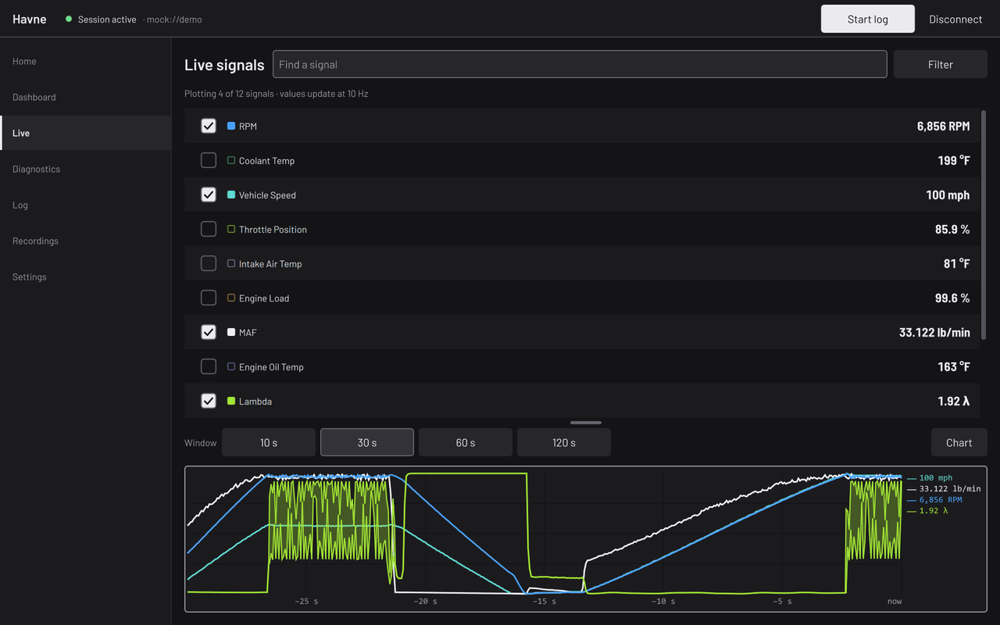
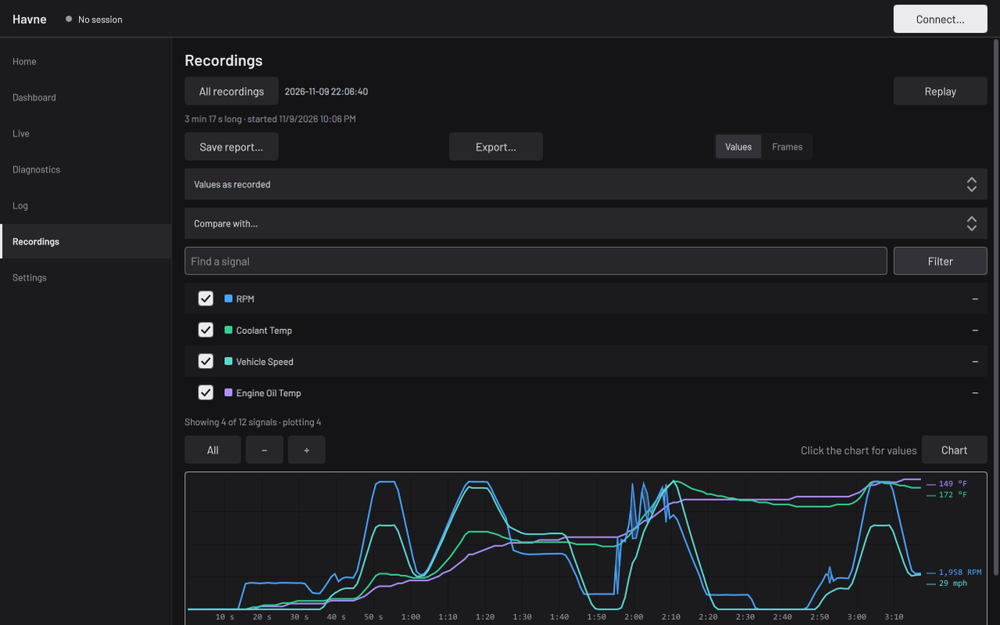
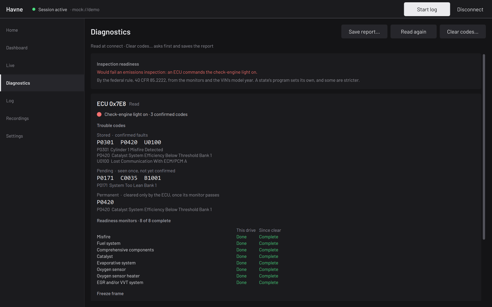
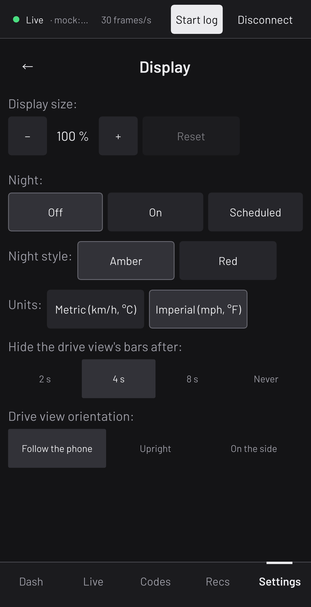

# User guide

How to do each task in the Havne app, on the desktop and on a phone. Each
section is the steps for one task. The address you connect with, and
every option it takes, is in [addresses.md](addresses.md).

The desktop's pages are in the sidebar: Home, Dashboard, Live,
Diagnostics, Log, Recordings and Settings. A phone has five tabs: Dash
(the Dashboard), Live, Codes (Diagnostics), Recs (Recordings) and
Settings; the Log opens from the status at the top. Below, a page is
named as the desktop names it, with the phone's tab beside it where it
differs.

Read [DISCLAIMER.md](../DISCLAIMER.md) before connecting to a car.

## Connect

### An adapter

1. Plug the adapter into the car's OBD-II port and turn the ignition on.
2. **Desktop:** open Home. Under **Adapters** it lists the J2534
   adapters and serial ports the computer has. Pick yours and press
   **Connect**. **Phone:** open Dash; with no session it shows the same
   list above the gauges.
3. The status at the top reads "Session active" with the address once
   the adapter answers. A connect that fails says why under the list;
   **Show log** has the rest.

Addresses that connected before are listed first, under **Recent**, so
the next time is one press.

To choose what's read (a profile), or for an adapter the list doesn't
show, connect from **Settings, Connection** instead: pick the adapter
from its list (or type an address in the field), pick a **Profile**
(Default reads OBD-II on an adapter; **raw (log only)** reads frames and
decodes nothing; **uds-generic (DIDs)** reads the DIDs you list), then
**Connect**. A WiFi adapter isn't listed: **Not listed: show** offers
the two common WiFi addresses, and the computer or phone must be on the
adapter's WiFi network first.

**Without a car:** in **Settings, Advanced**, tick **Developer mode**.
Home's list then has a **Demo data** row, and **Not listed: show** on
Connection has a `mock://demo` button: a simulated car that runs every
page.

### Bluetooth adapters

- **Android:** pair the adapter in Android's Bluetooth settings first.
  On Dash, the list says Havne needs Android's permission to list paired
  adapters: press **Allow** and allow nearby devices. The paired adapter
  then appears under **Adapters**. A Bluetooth LE adapter isn't paired:
  press **Scan** to find it. If Android stops asking, **Open settings**
  goes to Havne's page in Android's settings, where the permission can
  be turned on.
- **Windows:** pair the adapter in Windows' Bluetooth settings. Windows
  gives it a serial port (a COM number), which Home and Settings list as
  a serial port. Windows' **More Bluetooth settings, COM Ports** says
  which outgoing port is the adapter's.
- **Linux:** bind the paired adapter to a serial device with `rfcomm`
  ([linux.md, Adapters](linux.md#adapters)); it is then listed as
  `/dev/rfcomm0`.

### Serial ports on Linux

A serial port belongs to the `dialout` group (`uucp` on Arch). Without
it a connect fails with "permission denied: the user needs access to the
port". Add yourself once, then log out and back in:

```sh
sudo usermod -aG dialout "$USER"
```

[linux.md](linux.md#adapters) covers ModemManager, which can hold a port
open, and SocketCAN interfaces.

## Read live values

1. Connect, then open **Live**.
2. Each signal the session reads has a row with its value, updated ten
   times a second. A signal the ECU doesn't send is hidden, and a line
   under the list counts them.
3. Tick a row to plot it on the chart below; untick it to take it off.
   **Find a signal** narrows the list by name or unit, and **Filter**
   by the part of the car a signal reads, or to the plotted rows
   (**Plotted only**).
4. **Window** sets how many seconds the chart shows. **Chart** gives the
   chart the whole page, and **List** brings the list back.

Units follow **Settings, Display, Units** (metric or imperial).



## Edit the Dashboard

1. Open **Dashboard** (Dash) and press **Edit**.
2. **Add a gauge:** press **Add gauge** (or the **+** cell at the end),
   pick its kind (Dial, Ring, Bar, Cells, Number, Digits, Sparkline,
   Shift lights or Blank), then its signal. Its panel opens.
3. **Change a gauge:** click it (tap it on a phone). Out of edit mode,
   a long press on a gauge opens the same panel. It holds the label,
   the signal, the range (**From** and **To**), the color bands (**Cold below**,
   **Warning from**, **Danger from**), decimals, its size in columns and
   rows, **Peak hold**, its place (**Move earlier**, **Move later**),
   **Copy** and **Paste after**. **Close** shuts the panel.
4. **Move a gauge:** hold it and drag it to its new place.
5. **Remove a gauge:** press the **x** in its corner, or **Remove** in
   its panel.
6. **Pages:** the tabs above the gauges are the pages; **+** adds one.
   **Page** holds the shown page's name and **Remove page**, and
   **Reset**, which replaces every page with the built-in layout.
7. **Undo** and **Redo** step back and forth through the changes made
   since **Edit**; on the desktop, Ctrl+Z and Ctrl+Shift+Z (or Ctrl+Y)
   do the same, in edit mode or out of it. A change made from a panel
   outside edit mode offers its own Undo for a few seconds.
8. Press **Done**.

Each change is saved as it's made. The desktop and the phone keep a
layout each. Out of edit mode, the Left and Right arrow keys change
pages on the desktop, and a swipe does on a phone. **Reset peaks**
clears the peak marks; **Night** dims the page for a dark cabin.

## Log a drive

There are two ways to keep a drive.

**A log of chosen signals:**

1. On **Live**, tick the signals to log (the plotted ones are logged).
2. Press **Start log** in the top bar. Only the ticked signals are asked
   for while it runs, so each comes as often as the car answers. The
   top bar shows the log's time and size.
3. Press **Stop log**. The log opens on the Recordings page.

For a slow adapter or a busy ECU, **Settings, Advanced, Minimum time
between sweeps** spaces the requests out.

**Every session, whole:** in **Settings, Recording**, tick **Record
sessions**. From the next connect, each session's frames, values and
events are kept, and **Mark** in the top bar adds a marker to the
recording. While it records, Start log isn't offered: the recording
already holds every signal. **Open folder** on the same page shows
where recordings are kept.

## View and export a recording

1. Open **Recordings** (Recs). **All recordings** lists them, newest
   first; press one to open it.
2. Tick signals to plot them. Click the chart for the values at that
   time. **+** and the button beside it zoom in and out, **All** shows
   the whole recording, and **Values** and **Frames** switch between the
   decoded values and the raw frames.
3. **Export...** opens the export's choices:
   - the format: **CSV**, **pcapng** (for Wireshark) or **Folder** (a
     copy of the recording);
   - for CSV, **Wide** (a column for each signal) or **Long** (a row for
     each value), and how often a row is written;
   - which signals: the log's own or the ones plotted;
   - **Raw, not scrubbed**: left off, the file leaves out the vehicle's
     identification (its VIN and calibration IDs).

   Then **Save as...** and pick where.
4. **Replay** plays a recording back as a session, as if the car were
   connected. Disconnect first.

**Save report...** writes a health report of the recording: its codes,
readiness and key values. **Import** on the list brings in a candump log
or another logger's CSV as a recording.



## Read and clear codes

1. Connect with the ignition on, then open **Diagnostics** (Codes). The
   codes are read at connect.
2. The page shows the inspection verdict, then each ECU's stored,
   pending and permanent codes with their titles, the readiness
   monitors and the freeze frame. **Read again** reads them anew; **Look
   up a code** gives a code's title.
3. **Save report...** saves what's shown as text or JSON.

To clear the codes:

1. Stop the engine and leave the ignition on. Some ECUs refuse a clear
   with the engine running.
2. Press **Clear codes...**. Havne says what a clear erases and asks
   first. **Clear codes** goes ahead; **Cancel** sends nothing.
3. Havne saves the report to the recordings folder, then clears. If the
   report can't be saved, nothing is sent. The page then shows what the
   ECU reports after the clear.

A clear sets the readiness monitors back to incomplete, and the car can
fail an emissions inspection until some driving completes them.



## Add a vehicle and import signals

A vehicle keeps its own signal files and its last address. Vehicles
change only with no session connected: disconnect first.

1. Open **Settings, Vehicle**. Type a label ("Daily driver"; left empty,
   it's "Vehicle 1") and press **New**. The new vehicle is picked.
   **Duplicate** copies the picked vehicle, and **More** has Rename and
   Forget.
2. Open **Settings, Signals**:
   - **Import a signal file** adds a file of your own signals
     ([signal-files.md](signal-files.md) says how to write one);
   - **Import an OBDb set** converts a set from
     [OBDb](https://github.com/OBDb), saved on the device, for the
     vehicle. **OBDb model year** beside it is the year to convert for;
     a VIN looked up on the Vehicle page fills it in. The report shows
     what converted and what was left out; **Keep** adds it,
     **Discard** doesn't;
   - **Add a signal**, under **Your own signals**, writes one signal at
     a time.
3. Each file is then a profile of its own on **Settings, Connection**,
   under **Profile**. Pick it and connect.

**Look up a VIN** on the Vehicle page decodes a VIN's model year and
make on the device; the VIN isn't saved.

## The drive view

On a phone, the drive view shows the Dash page's gauges with every bar
hidden, and keeps the screen on.

1. Connect, open Dash and press **Drive**.
2. Tap the gauges to bring the controls up from the bottom: Start log or
   Stop log, Mark while a recording runs, Disconnect, Reset peaks,
   Night and **Exit drive**. They slide away again by themselves.
3. Press **Exit drive** to leave the view.

The status line at the top stays: the link's state, the address, and a
running log's time. Havne remembers the view: left on, it comes back by
itself at the next connect made from Dash. In **Settings, Display**,
**Hide the drive view's bars after** sets how long the controls stay
up, and **Drive view orientation** holds the phone upright or on its
side while in the view.


