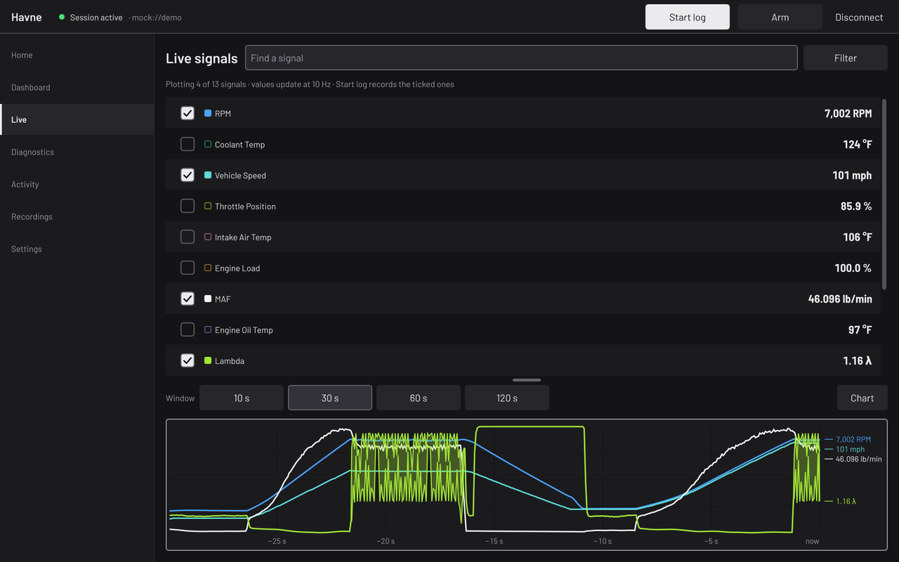
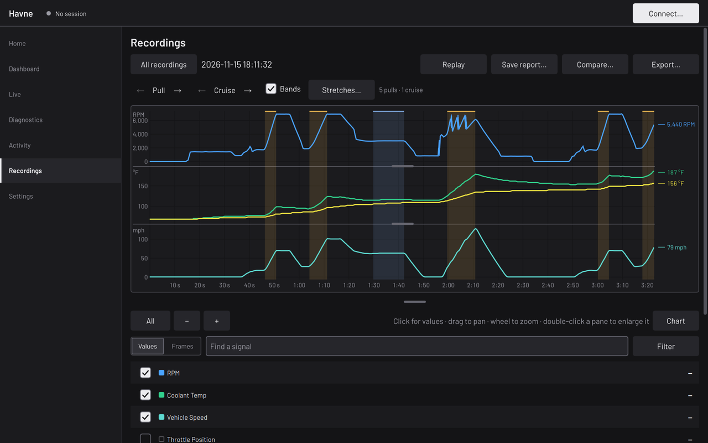
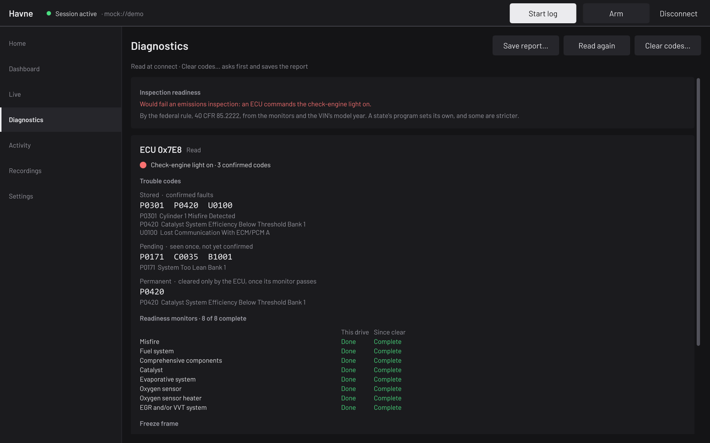
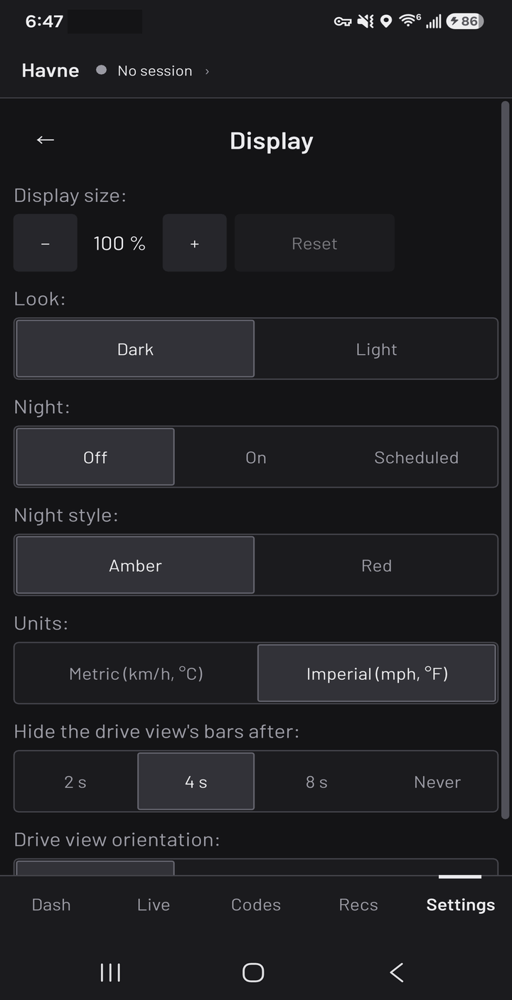

# User guide

How to do each task in the Havne app, on the desktop and on a phone. Each
section is the steps for one task. The address you connect with, and
every option it takes, is in [addresses.md](addresses.md).

The desktop's pages are in the sidebar: Home, Dashboard, Live,
Diagnostics, Activity, Recordings and Settings. A phone has five tabs: Dash
(the Dashboard), Live, Codes (Diagnostics), Recs (Recordings) and
Settings; Activity opens from the status at the top. Below, a page is
named as the desktop names it, with the phone's tab beside it where it
differs.

Read [DISCLAIMER.md](../DISCLAIMER.md) before connecting to a car.

## Connect

### An adapter

1. Plug the adapter into the car's OBD-II port and turn the ignition on.
2. **Desktop:** open Home. Under **Adapters** it lists the J2534
   adapters and serial ports the computer has. Pick yours and press
   **Connect**. **Phone:** open Dash; with no session it shows the same
   list above the gauges.
3. The status at the top reads "Session active" with the address once
   the adapter answers. A connect that fails says why under the list;
   **Show activity** has the rest.

Addresses that connected before are listed first, under **Recent**, so
the next time is one press.

To choose what's read (a profile), or for an adapter the list doesn't
show, connect from **Settings, Connection** instead: pick the adapter
from its list (or type an address in the field), pick a **Profile**
(Default reads OBD-II on an adapter; **raw (log only)** reads frames and
decodes nothing, and they are on the Activity page's **Frames** view;
**uds-generic (DIDs)** reads the DIDs you list), then **Connect**. Under
uds-generic, **Extended session (10 03)** enters the extended diagnostic
session before the reads, over an adapter or a CAN interface; the other
options go after `?` in the address ([addresses.md](addresses.md)). A WiFi
adapter isn't listed: **WiFi and other addresses: show** offers the two
common WiFi addresses, and the computer or phone must be on the adapter's
WiFi network first.

Settings composes the address from a preset or a device (a J2534
interface or a serial port), a profile row (default, `raw`,
`uds-generic`, the picked vehicle's signal files and plugin variant) and
a DID field, and leaves the address field editable: a typed address sets
the row and the field from its `profile=` and `did=`, and the next click
recomposes it with every other key kept. Core judges the result at
connect, and Settings shows its words. The header opens Settings, and
the connect lists on Home and Dash hand it the address of the row
chosen.

**Without a car:** Home's and Dash's lists end with a **Demo data** row,
and **WiFi and other addresses: show** on Connection has a `mock://demo`
button: a simulated car that runs every page. Replaying a recording is
done from Recordings.

### Bluetooth adapters

- **Android:** pair the adapter in Android's Bluetooth settings first.
  On Dash, the list says Havne needs Android's permission to list paired
  adapters: press **Allow** and allow nearby devices. The paired adapter
  then appears under **Adapters**. A paired headset, watch or health
  device is listed apart, under **Other paired devices**. A Bluetooth LE
  adapter isn't paired:
  press **Scan** to find it. If Android stops asking, **Open settings**
  goes to Havne's page in Android's settings, where the permission can
  be turned on.
- **Windows:** pair the adapter in Windows' Bluetooth settings. Windows
  gives it a serial port (a COM number), which Home and Settings list as
  a serial port. Windows' **More Bluetooth settings, COM Ports** says
  which outgoing port is the adapter's.
- **Linux:** bind the paired adapter to a serial device with `rfcomm`
  ([linux.md, Adapters](linux.md#adapters)); it is then listed as
  `/dev/rfcomm0`.

### Serial ports on Linux

A serial port belongs to the `dialout` group (`uucp` on Arch). Without
it a connect fails with "permission denied: the user needs access to the
port". Add yourself once, then log out and back in:

```sh
sudo usermod -aG dialout "$USER"
```

[linux.md](linux.md#adapters) covers ModemManager, which can hold a port
open, and SocketCAN interfaces.

## Read live values

1. Connect, then open **Live**.
2. Each signal the session reads has a row with its value, updated ten
   times a second. A signal the ECU doesn't send is hidden, and a line
   under the list counts them.
3. Tick a row to plot it on the chart below; untick it to take it off.
   **Find a signal** narrows the list by name or unit, and **Filter**
   by the part of the car a signal reads, or to the plotted rows
   (**Plotted only**).
4. **Window** sets how many seconds the chart shows. **Chart** gives the
   chart the whole page, and **List** brings the list back.
5. Drag the chart to pause it and look back through the last two minutes
   while the values keep updating; a tap reads each trace's value at that
   moment. **Live** (or Space on a desktop) follows now again.

A value never received shows "—", never a made-up 0. A value older than
3 s dims, and ages refresh every tick, so a signal that stops arriving
dims even when nothing else changes.

Units follow **Settings, Display, Units** (metric or imperial).



## Edit the Dashboard

1. Open **Dashboard** (Dash) and press **Edit**.
2. **Add a gauge:** press **Add gauge** (or the **+** cell at the end),
   pick its kind (Dial, Ring, Bar, Cells, Number, Digits, Sparkline,
   Shift lights or Blank), then its signal. Its panel opens.
3. **Change a gauge:** click it (tap it on a phone; edit mode says so,
   and the panel shows the gauge it edits). Out of edit mode,
   a long press on a gauge opens the same panel. It holds the label,
   the signal (**Change signal**), its kind (**Change kind**: the signal,
   range, zones and size stay, and settings only the old kind used come
   back if you change back), the range (**From** and **To**), the zones
   (**Cold below**, **Warning below**, **Danger below**, **Warning from**,
   **Danger from**), decimals, **Color**, its size (**Columns** and
   **Rows**; on a phone, **Columns** and **Height**, both counted in
   columns),
   **Peak hold**, its place (**Move earlier**, **Move later**), **Copy**
   and **Paste after**. **Close** shuts the panel.

   A gauge colors normal, cold, warning and danger by level; each of warning
   and danger can be set above or below a value. A new gauge on a common
   signal starts with generic zones for a gasoline engine, not a diagnosis;
   they are ordinary values to type over or clear. Zones, Decimals and Color
   apply to every kind but Shift lights. Color is one of a set of named
   colors, **Custom...** (a color of your own from three numbers, red,
   green and blue, each 0 to 255) or Default (the look's own); a color
   hard to read on one of the looks says so and is kept all the same. A
   warning zone and Night still draw in their
   colors, and at Night the row is dimmed, with a note: Night draws every
   gauge in its own tint, and your pick comes back by day.
4. **Move a gauge:** hold it and drag it to its new place.
5. **Remove a gauge:** press the **x** in its corner, or **Remove** in
   its panel.
6. **Pages:** the tabs above the gauges are the pages; **+** adds one.
   **Page** holds the shown page's name and **Remove page**, and
   **Reset**, which replaces every page with the built-in layout.

   **Export layout** writes this form's layout to a `.json` file, and
   **Load layout** reads one back. A file names the form it came from
   (phone or desktop) and is refused on the other: layouts are not scaled
   between forms. Where a gauge reads a signal file's signal, the export
   lists that file by name, and loading says which files this vehicle
   does not have, so you can import them under Signals; the gauges read
   "not in profile" until you do. A load is one undo step, so Undo takes
   the previous layout back. A file that cannot be read, or was made by a
   newer version, is refused with the reason and changes nothing; gauges
   or pages in a file that cannot be read are left out and counted.
   `havne-cli layout check <file>` reads a layout file as Load layout
   would, with no app.
7. **Undo** and **Redo** step back and forth through the changes made
   since **Edit**; on the desktop, Ctrl+Z and Ctrl+Shift+Z (or Ctrl+Y)
   do the same, in edit mode or out of it. A change made from a panel
   outside edit mode offers its own Undo for a few seconds.
8. Press **Done**.

Each change is saved as it's made. The desktop and the phone keep a
layout each. Out of edit mode, the Left and Right arrow keys change
pages on the desktop, and a swipe does on a phone. **Reset peaks**
clears the peak marks; **Night** dims the page for a dark cabin.

## Log a drive

There are two ways to keep a drive.

**A log of chosen signals:**

1. On **Live**, tick the signals to log (the plotted ones are logged).
2. Press **Start log** in the top bar. Only the ticked signals are asked
   for while it runs, so each comes as often as the car answers. The
   top bar shows the log's time and size, and from a window 720 px wide
   **Mark** beside it adds a marker to the log.
3. Press **Stop log**. The log opens on the Recordings page.

For a slow adapter or a busy ECU, **Settings, Advanced, Minimum time
between sweeps** spaces the requests out.

**Every session, whole:** in **Settings, Recording**, tick **Record
sessions**. From the next connect, each session's frames, values and
events are kept, and **Mark** in the top bar adds a marker to the
recording. While it records, Start log isn't offered: the recording
already holds every signal, and **Settings, Recording** says so. **Open folder** on the same page shows
where recordings are kept.

**Armed:** an **Armed** button beside Start log (and in the drive
view's controls) keeps a recorder waiting. It records nothing until a
condition set to record fires (see [Alerts](#alerts-and-conditions)),
then writes a recording of its own for each window, from the
condition's **Before** seconds ahead of its firing to its **After**
seconds past the last condition turning off. The button is off, with its
reason, while no condition records, and its label says whether it waits
or is recording a window. Press it again to stop.

## Alerts and conditions

An alert is a condition on the session's signals or its link, judged
as the frames arrive. **Settings, Alerts** lists them.

1. Press **Add** and fill in the editor: **Name**, **What it watches**
   (**A signal**, **The link**: not OK, not responding, requests
   failing or adapter lost, or a recording's frames check finding) and
   **Alert** as **Warning** or **Danger**. For a signal give **Above** or
   **Below**, the **Level** (in your units) and a **Clears above** or
   **Clears below** level so it doesn't flicker, and **On after** and
   **off after** seconds. **Add a term** and **All of these** or **Any
   of these** combine several.
2. **Banner** shows the alert as a band under the header on every page,
   and over the gauges in the drive view: the highest alert first (a
   danger above a warning, then the newest), with the value it fired at.
   It stays at least 3 seconds and says when nothing new has been read
   for it. A gauge or Live value that the alert reads takes its color.
   **Sound** plays a short tone on Android: one beep for a warning, two
   for a danger, at most once in 5 seconds for each alert, at the alarm
   volume.
3. **Record** (with **Before** and **After** seconds) makes the
   condition start an armed recording, and **Mark the recording** adds a
   marker when it fires.
4. **Add from a signal's levels** makes alerts from the danger and
   warning levels a gauge was given; a gauge's own panel has the same
   in its **Alert** button.
5. **Import...** and **Export...** read and write a condition file
   ([condition-files.md](condition-files.md)); an import replaces the
   saved alerts with the file's. With a condition file saved
   that doesn't load, the page says why and **Start again** replaces it
   (the unreadable file is kept beside it).

## View and export a recording

1. Open **Recordings** (Recs). **All recordings** lists them, newest
   first, each row saying how long the recording is, whether it is a log
   of chosen signals or a whole session, its signal count and its marks;
   press one to open it.
2. Tick signals to plot them. Click the chart for the values at that
   time. **+** and the button beside it zoom in and out, **All** shows
   the whole recording, and **Values** and **Frames** switch between the
   decoded values and the raw frames.
3. **Export...** opens the export's choices:
   - the format: **CSV**, **pcapng** (for Wireshark) or **Folder** (a
     copy of the recording);
   - for CSV, **Wide** (a column for each signal) or **Long** (a row for
     each value), and how often a row is written: **Every sweep** writes a
     row once each signal has a new value, except a signal far sparser
     than the rest (an event counter, say), whose newest value goes in
     the others' rows;
   - which signals: the log's own or the ones plotted;
   - **Raw, not scrubbed**: left off, the file leaves out the vehicle's
     identification (its VIN and calibration IDs).

   Then **Save as...** and pick where.
4. **Replay** plays a recording back as a session, as if the car were
   connected. Disconnect first.

The chart is in panes, one for each unit, stacked on one time axis, each
with its own value axis. On the desktop, Ctrl and the wheel over a pane
zoom its range, and a drag on its axis pans it; on a phone, pinch up and
down. A double click or tap on an axis puts the range back, and dragging the
line between two panes sets their heights, which are kept.

A click or tap places the cursor, and each row shows the value there. A
second cursor goes in with Shift+click, or a long press on a phone; dragging
a box with Shift pressed places both at once. The span between them shows
its length, **Zoom to span** fits the chart to it, and **Clear** removes the
second cursor. Each signal's row then shows the span's change, lowest,
highest, mean and rate. Handles at the chart's foot move the cursors. On the
desktop the arrow keys step the cursor a sample, **B** picks the other
cursor, and Home and End go to the ends of the recording.

Under the title row (under the chart on a phone) the Jump row steps
between pulls and cruises: the arrows move the view to the previous or
next one, with the cursor at its start, and the line beside them says
which one you are at. Each is a band on the chart; **Bands** turns them
off. **Stretches...** opens the levels the finder uses; an empty field, or
0, takes the default shown in it, and **Apply** finds them again. The pull
numbers in Compare follow these levels; `havne-cli`'s `--align-on` counts
by core's defaults unless it is given levels.

A recording that holds conditions draws each time one was ON as a bar
along the chart's foot (an alert's in its level's color, under the
others), and each stretch where nothing fresh was read dashed.
**Conditions...** beside **Stretches...** lists them with their start and
length; a row moves the view there.

**Save report...** writes a health report of the recording: its codes,
readiness and key values. **Import** on the list brings in a candump log
or another logger's CSV as a recording, with an optional **Label**; the
recording opens when the import ends, and a CSV whose times carry dates is
listed at the drive's time. **Cancel** stops an import that is running:
nothing is imported and the panel keeps your choices. A CSV row with no time
is left out, and the import says how many it left out.

**Compare...**, beside **Export**, lines two recordings up. **Align a pull** lines them up on a
pull you choose in each: a pull is full throttle for a second or more
while the car accelerates. Each recording's pulls are listed with their
start and length; the first of each is chosen to begin with. Use it to
lay a pull from before a change over the same pull after it.
**Difference** adds, for each plotted signal both recordings hold in the
same unit, a trace of the compared recording less this one, in a pane of
its own: a flat line at zero means the two agree there. With
`havne-cli view`, `--align-on pull:2` puts every recording's second pull
at 0, and `pull:3,1` the first recording's third and the second's first;
each `columns` line then carries the column's `mean`, and the later
recording's line its `delta` from the first.



## Read and clear codes

1. Connect with the ignition on, then open **Diagnostics** (Codes). The
   codes are read at connect.
2. The page shows the inspection verdict, then each ECU's stored,
   pending and permanent codes with their titles, the readiness
   monitors and the freeze frame. **Read again** reads them anew; **Look
   up a code** gives a code's title.
3. **Save report...** saves what's shown as text or JSON.

To clear the codes:

1. Stop the engine and leave the ignition on. Some ECUs refuse a clear
   with the engine running.
2. Press **Clear codes...**. Havne says what a clear erases and asks
   first. **Clear codes** goes ahead; **Cancel** sends nothing.
3. Havne saves the report to the recordings folder, then clears. If the
   report can't be saved, nothing is sent. The page then shows what the
   ECU reports after the clear.

A clear sets the readiness monitors back to incomplete, and the car can
fail an emissions inspection until some driving completes them.



## Add a vehicle and pick its signals

Signals beyond the built-in profiles come as **plugins**: a package someone made for a model, a signal file you wrote, or a set converted from [OBDb](https://github.com/OBDb). A plugin has one or more **variants** (a model year, a trim), and a vehicle **picks** the variants it reads. Vehicles and picks change only with no session connected: disconnect first (the page says so while a session runs).

1. Open **Settings, Vehicle**. Type a label ("Daily driver"; left empty, it's "Vehicle 1") and press **New**. The new vehicle is picked. **Duplicate** copies the picked vehicle with its picks, and **More** has Rename and Forget.
2. Open **Settings, Signals** and press **Import...**. It takes three kinds of file:
   - a plugin package (`<id>.havne-plugin.json`) goes in as it is;
   - a signal file ([signal-files.md](signal-files.md) says how to write one) asks where it goes: **As a new plugin**, or **Into** one of your own plugins as another variant;
   - an OBDb set, downloaded first and saved on the device, shows a report of what converted and what was left out. **OBDb model year** is the year to convert for (a VIN looked up on the Vehicle page fills it in); **Keep** makes it a plugin of your own, **Discard** doesn't.
3. Every plugin is listed with a row for each variant. The plugins for this car come first: those the vehicle picks from, those imported for it and those its VIN matches. Press a row to pick it for the picked vehicle; press it again to undo the pick. An import that gives a single variant is picked at once.
4. Each pick is a profile on **Settings, Connection**, under **Profile**. On an adapter, the first pick that also reads the OBD-II signals stands where Default does ("obd2 + Daily driver extras"). Home's and the Dashboard's connect lists read that pick without a visit to Settings.

**More** on a row has the rest: **Save as a signal file...**, **Export plugin...** (a package another Havne imports), **Copy to my plugin** for a variant of someone else's plugin you want to change, **Replace...** and **Remove this variant** for your own, **Mine** to mark an imported plugin as yours (a newer export of it then updates it in place), and **Remove**. Removing a plugin of your own asks first: no other copy exists.

**Add a signal**, under **Your own signals**, writes one signal at a time into the vehicle's own plugin ("Daily driver signals"). **Edit** changes a saved one; a new name keeps every gauge that shows the signal bound to it.

**Look up a VIN** on the Vehicle page decodes a VIN's model year and make on the device, and marks the variants that VIN matches; the VIN isn't saved.

## The drive view

On a phone, the drive view shows the Dash page's gauges with every bar
hidden, and keeps the screen on.

1. Connect, open Dash and press **Drive**.
2. Tap the gauges to bring the controls up from the bottom: Start log or
   Stop log, Armed, Mark while Record sessions records or a log runs,
   Disconnect, Reset peaks,
   Night and **Exit drive**. They slide away again by themselves.
3. Press **Exit drive** to leave the view.

An alert whose condition has a banner shows over the gauges. The status line at the top stays: the link's state, the address, and a
running log's time. Havne remembers the view: left on, it comes back by
itself at the next connect made from Dash. In **Settings, Display**,
**Hide the drive view's bars after** sets how long the controls stay
up, and **Drive view orientation** holds the phone upright or on its
side while in the view.


